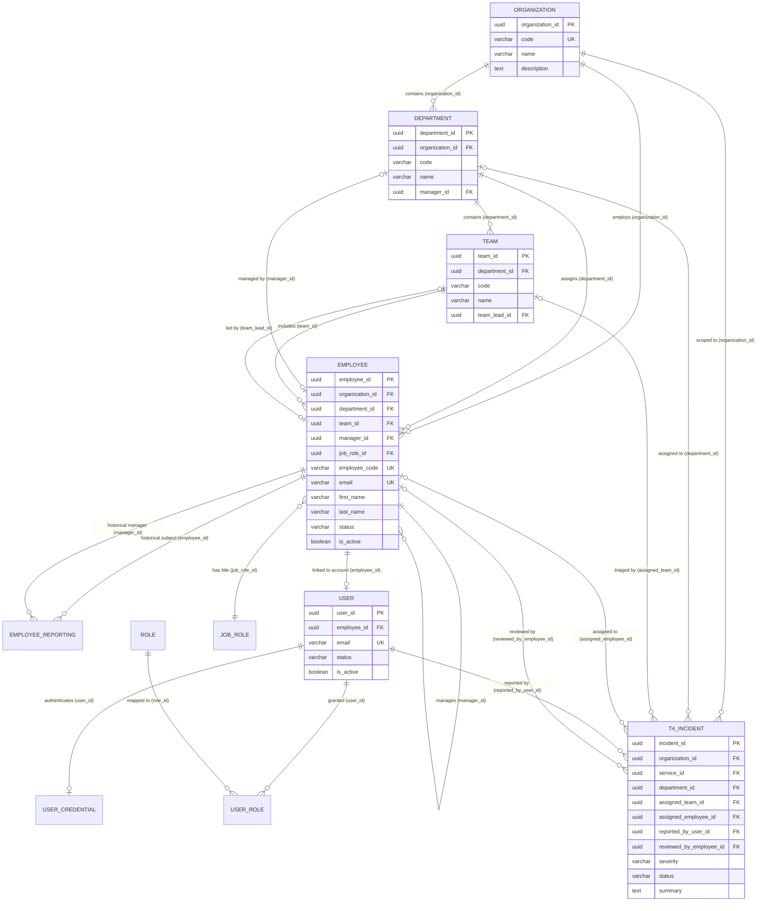
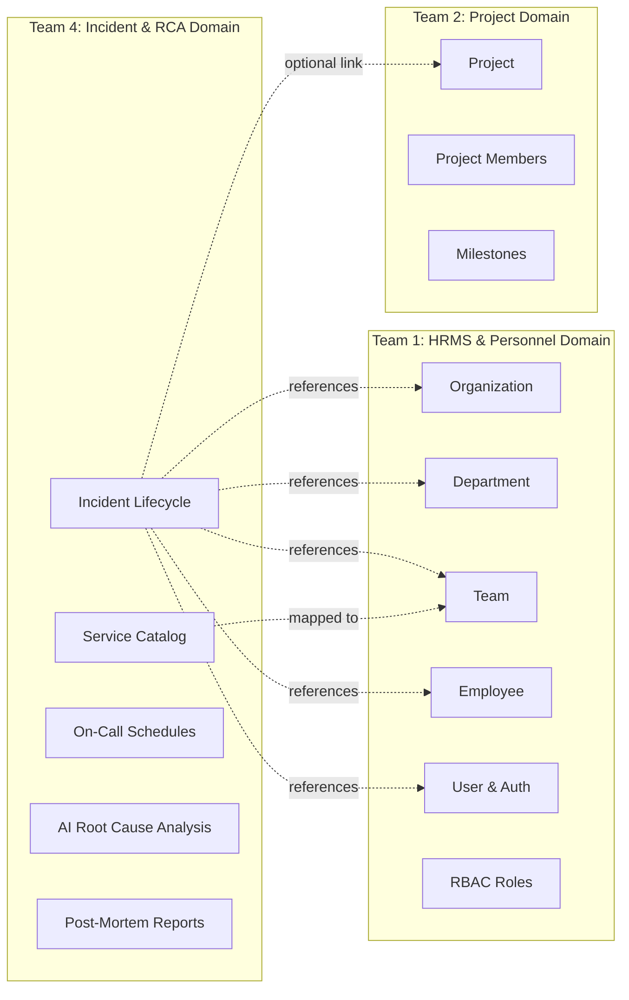

# Nexora HRMS Team 1 — Team 4 Incident Management & RCA Integration Contract

**Document Version:** 1.0.0  
**Target Audience:** Nexora Team 4 (Incident Management & AI Root Cause Analysis)  
**Authoring Team:** Team 1 (Core HRMS, Organization & Identity)  
**Source Repository:** `D:\nexora\Nexora_HRMS_Backend`  
**Classification:** Authoritative Technical Integration Contract & Architecture Audit  

---

## Executive Summary

This document establishes the authoritative technical integration contract between **Team 1** (Core HRMS, Identity & Organization Architecture) and **Team 4** (Incident Management, Alert Routing & AI Root Cause Analysis).

Team 4 requires organizational data from Team 1 to power:
1. **Incident Attribution:** Identifying incident reporters, responders, assignees, and post-mortem approvers.
2. **Squad & Department Ownership:** Routing alerts to responsible teams, escalation to team leads and engineering managers.
3. **Personnel Availability & Eligibility:** Validating active employment status, role permissions, and hierarchical reporting lines.

### Critical Takeaways for Team 4

> [!IMPORTANT]
> 1. **Canonical Identifiers are UUIDs:** Team 1 primary keys are immutable RFC 4122 UUIDs (`organization_id`, `department_id`, `team_id`, `employee_id`, `user_id`). Team 4 **must store UUIDs as foreign keys** in all incident tables. Business codes (`code`, `employee_code`) are mutable display strings and must **never** be used as primary foreign keys.
> 2. **`user_id` vs. `employee_id`:**  
>    - `user_id` represents an **authentication account** (login credentials, sessions, audit actor). Use for `reported_by_user_id` and audit logs. Not all users have an employee record.  
>    - `employee_id` represents a **corporate personnel record** (department, team, manager, job title, employment status). Use for `assigned_employee_id` and escalation workflows.
> 3. **Service Ownership is Not Implemented in Team 1:** Team 1 does **not** maintain a microservice catalog or service-to-team mapping. Team 4 must own the Service Catalog or establish a dedicated service ownership model referencing Team 1's `team_id` and `organization_id`.
> 4. **Project Entity is Owned by Team 2:** Team 1 does not own project delivery structures or project-level issue tracking. Team 4 must consume `project_id` and project membership directly from Team 2.
> 5. **Safe Soft Deactivation:** Calling `DELETE /employees/{id}` performs a **soft deactivation** (`status = 'inactive'`, `is_active = false`). Personnel records are **never hard-deleted**, ensuring historical incident references remain referentially valid indefinitely.

---

## 1. Organization and Project References

### 1.1 Organization Representation
* **Physical Base Table:** `organization`
* **Compatibility View:** `organizations`
* **Canonical Identifier:** `organization_id` (PostgreSQL `uuid`, RFC 4122)
* **Business Identifier:** `code` (PostgreSQL `varchar(50)`, UNIQUE, e.g. `APEX-TECH`)

### 1.2 Organization Retrieval APIs
Team 4 can retrieve organization metadata via:
- `GET /api/v1/organizations/{organization_id}`: Retrieves tenant name, business code, timezone, and description.
- `GET /api/v1/organizations/{organization_id}/structure`: Retrieves the full hierarchical breakdown of departments and teams.

### 1.3 How Authenticated Users are Associated with Organizations
In Team 1's architecture, `"user"` does **not** contain an `organization_id` column. A user's organizational context is resolved through:
1. **Active Employment Link:** The `employee` record where `employee.user_id = "user".user_id` (or `user.employee_id = employee.employee_id` or matching email).
2. **Organization Registration Link:** Prospective admins linked via `organization_registrations.organization_id` where `organization_registrations.user_id = "user".user_id`.
3. **Role Assignments:** Roles granted via `user_role` scoped to the organization where the employee belongs.

### 1.4 Establishing and Validating Organization Context
When Team 4 processes incident requests:
1. **Never trust client-supplied `organization_id` without validation.** An authenticated caller may pass `organization_id` in the request header or payload, but Team 4 must verify that the caller is an active member of that organization.
2. **Verification Flow:**
   - Call Team 1's `GET /api/v1/auth/me` using the caller's Bearer token to obtain the caller's `user_id` and `employee_ids`.
   - If `employee_id` is present, call `GET /api/v1/employees/{employee_id}` to verify `organization_id`.
   - Alternatively, attempt `GET /api/v1/organizations/{organization_id}` with the caller's Bearer token. Team 1 returns `403 Forbidden` if the caller does not belong to that organization.

### 1.5 Project Ownership Boundaries
* **Team 2 Ownership:** Team 2 owns the `Project` entity (`projects`, `project_members`, project roadmaps, and delivery milestones).
* **Team 1 Boundaries:** Team 1 only provides the core organization (`organization_id`) and personnel (`employee_id`).
* **Team 4 Guidance:** If an incident relates to a project failure (e.g. `project_id`), Team 4 must validate that `project_id` with Team 2's service. Team 1 cannot validate project keys or project scopes.

---

## 2. User, Employee, Department and Team Identifiers

### 2.1 Entity Schemas & Database Structure

#### 2.1.1 `organization` (Base Table)
* **Physical Table:** `organization`
* **Primary Key:** `organization_id` (`uuid`, PK)
* **Foreign Keys:** None (Root Tenant)
* **Key Fields:** `name` (`varchar(255)`, NOT NULL), `code` (`varchar(50)`, UNIQUE, NOT NULL), `description` (`text`, NULL), `industry` (`varchar(100)`, NULL), `address` (`text`, NULL), `created_at` (`timestamptz`), `updated_at` (`timestamptz`).
* **SQLAlchemy Model:** `Organization` in [`app/modules/organizations/models.py`](file:///d:/nexora/Nexora_HRMS_Backend/app/modules/organizations/models.py).

#### 2.1.2 `department`
* **Physical Table:** `department`
* **Primary Key:** `department_id` (`uuid`, PK)
* **Foreign Keys:**
  - `organization_id` $\rightarrow$ `organization(organization_id)` (`ON DELETE NO ACTION`)
  - `manager_id` $\rightarrow$ `employee(employee_id)` (`ON DELETE SET NULL / NO ACTION`)
* **Key Fields:** `name` (`varchar(255)`, NOT NULL), `code` (`varchar(50)`, NOT NULL, Composite UNIQUE with `organization_id`), `description` (`text`, NULL).
* **Virtual Fields:** `status` is a SQLAlchemy `column_property(literal("active"))`; no physical `status` column exists.
* **SQLAlchemy Model:** `Department` in [`app/modules/departments/models.py`](file:///d:/nexora/Nexora_HRMS_Backend/app/modules/departments/models.py).

#### 2.1.3 `team`
* **Physical Table:** `team` (Singular)
* **Primary Key:** `team_id` (`uuid`, PK)
* **Foreign Keys:**
  - `department_id` $\rightarrow$ `department(department_id)` (`ON DELETE RESTRICT`)
  - `team_lead_id` $\rightarrow$ `employee(employee_id)` (`ON DELETE SET NULL / NO ACTION`)
* **Key Fields:** `name` (`varchar(255)`, NOT NULL), `code` (`varchar(50)`, NOT NULL, Composite UNIQUE with `department_id`), `description` (`text`, NULL).
* **Virtual Fields:** `status` is a SQLAlchemy `column_property(literal("active"))`.
* **SQLAlchemy Model:** `Team` in [`app/modules/teams/models.py`](file:///d:/nexora/Nexora_HRMS_Backend/app/modules/teams/models.py).

#### 2.1.4 `employee`
* **Physical Table:** `employee`
* **Primary Key:** `employee_id` (`uuid`, PK)
* **Foreign Keys:**
  - `organization_id` $\rightarrow$ `organization(organization_id)`
  - `department_id` $\rightarrow$ `department(department_id)`
  - `team_id` $\rightarrow$ `team(team_id)` (Indexed: `employees_team_id_idx`)
  - `manager_id` $\rightarrow$ `employee(employee_id)` (Self-reference; Top admin points to self)
  - `job_role_id` $\rightarrow$ `job_role(job_role_id)` (Indexed: `employees_job_role_id_idx`)
* **Key Fields:**
  - `employee_code` (`varchar(50)`, UNIQUE, e.g. `APEX-EMP001`)
  - `first_name` (`varchar(100)`, NOT NULL), `last_name` (`varchar(100)`, NULL)
  - `email` (`varchar(255)`, UNIQUE, NOT NULL)
  - `phone` (`varchar(50)`, NULL)
  - `hire_date` (`date`, NOT NULL)
  - `employment_type` (`varchar(50)`, CHECK: `full_time`, `part_time`, `contract`, `intern`)
  - `status` (`varchar(50)`, NOT NULL, values: `active`, `inactive`)
  - `is_active` (`boolean`, NOT NULL, default `true`)
* **Computed Model Properties:** `job_title` (from `job_role.name`), `user_id` (from `"user".user_id`).
* **SQLAlchemy Model:** `Employee` in [`app/modules/employees/models.py`](file:///d:/nexora/Nexora_HRMS_Backend/app/modules/employees/models.py).

#### 2.1.5 `"user"`
* **Physical Table:** `"user"` (Quoted identifier in PostgreSQL)
* **Primary Key:** `user_id` (`uuid`, PK)
* **Foreign Keys:** `employee_id` $\rightarrow$ `employee(employee_id)` (NULLABLE, 1:1)
* **Key Fields:** `email` (`varchar(255)`, UNIQUE, NOT NULL), `phone` (`varchar(50)`, NULL), `status` (`varchar(50)`, values: `active`, `inactive`, `unverified`), `is_active` (`boolean`, NOT NULL), `last_login_at` (`timestamp`, NULL).
* **SQLAlchemy Model:** `User` in [`app/modules/users/models.py`](file:///d:/nexora/Nexora_HRMS_Backend/app/modules/users/models.py).

#### 2.1.6 `role` and `user_role`
* **Physical Table `role`:**
  - `role_id` (`uuid`, PK), `name` (`varchar(100)`), `code` (`varchar(50)`, UNIQUE: `ORG_ADMIN`, `HR_MANAGER`, `MANAGER`, `EMPLOYEE`), `description` (`text`), `is_system` (`boolean`).
  - *Note:* In the physical schema, `role` is global and has no `organization_id` column.
* **Physical Table `user_role`:**
  - `user_role_id` (`uuid`, PK), `user_id` (`uuid`, FK $\rightarrow$ `"user"`), `role_id` (`uuid`, FK $\rightarrow$ `role`), `assigned_at` (`timestamp`), `assigned_by` (`uuid`, FK $\rightarrow$ `"user"`).

---

### 2.2 Distinguishing `user_id` from `employee_id`

```
┌─────────────────────────────────────────────────────────────────────────────────────────────────┐
│                               USER_ID vs EMPLOYEE_ID COMPARISON                                 │
├──────────────────────┬────────────────────────────────────┬─────────────────────────────────────┤
│ Dimension            │ user_id (Authentication Principal) │ employee_id (Organizational Member) │
├──────────────────────┼────────────────────────────────────┼─────────────────────────────────────┤
│ Physical Table       │ "user"                             │ employee                            │
│ Primary Purpose      │ Identity, login, auth credentials  │ Corporate personnel, squad & dept   │
│ Guaranteed Existence │ Every authenticated caller         │ Only provisioned employees          │
│ Scoped to Org?       │ Global account identifier          │ Strictly scoped to organization_id  │
│ Has Squad/Team?      │ No                                 │ Yes (team_id, department_id)        │
│ Has Manager?         │ No                                 │ Yes (manager_id, employee_reporting)│
└──────────────────────┴────────────────────────────────────┴─────────────────────────────────────┘
```

> [!WARNING]
> **Do not assume all users have employee records:**  
> Newly registered organization administrators who have completed email OTP challenge but have not yet finalized employee profile generation will possess a valid `user_id` but `employee_id = None`. External API tokens or automated service integrations will also operate at the `user_id` layer.

### 2.3 Recommended Identifier Usage in Team 4 Incident Models

| Incident Field | Identifier Type | Target Reference | Architectural Justification |
| :--- | :--- | :--- | :--- |
| **Incident Reporter** | `reported_by_user_id` | `uuid` $\rightarrow$ `"user"` | Captures the exact authenticated user account that filed the incident, even if they lack an employee profile or are a system user. Optional secondary field: `reported_by_employee_id`. |
| **Incident Assignee** | `assigned_employee_id` | `uuid` $\rightarrow$ `employee` | Incident remediation tasks must be assigned to an active corporate employee who belongs to a squad, has a manager, and can be paged. |
| **Squad Assignment** | `assigned_team_id` | `uuid` $\rightarrow$ `team` | Identifies the engineering squad accountable for the incident (e.g. Core Platform, Billing). |
| **Department Ownership**| `department_id` | `uuid` $\rightarrow$ `department` | High-level organizational escalation and reporting (e.g. Engineering, Infrastructure). |
| **Reviewer / Approver** | `reviewed_by_user_id` | `uuid` $\rightarrow$ `employee` or `"user"` | Personnel authorized to sign off on Post-Mortems / Root Cause Analysis (RCA). |

---

## 3. Service Ownership Investigation & Findings

### 3.1 Audit Findings in Team 1 Codebase
We performed an exhaustive audit of all SQLAlchemy models in `app/db/base/registry.py` and the PostgreSQL database:
* **Service Catalogue:** **NOT IMPLEMENTED** in Team 1.
* **Service-to-Organization Mapping:** **NOT IMPLEMENTED** in Team 1.
* **Service-to-Team Mapping:** **NOT IMPLEMENTED** in Team 1.
* **Service Owner Employee/User Mapping:** **NOT IMPLEMENTED** in Team 1.
* **Ownership / Responsibility Tables:** **NOT IMPLEMENTED** in Team 1.

Team 1 is strictly an HRMS core platform (Organizations, Departments, Teams, Employees, Job Roles, Attendance, Leave, RBAC). Microservice definitions and system architectures do not belong in Team 1's domain.

### 3.2 Proposed Integration Model for Team 4 Service Ownership (Recommendation)

Team 4 should implement and maintain the Service Catalog entity within Team 4's database schema, using canonical Team 1 UUIDs as foreign references:

```sql
-- PROPOSED SCHEMA FOR TEAM 4 (RECOMMENDATION ONLY)
CREATE TABLE incident_service (
    service_id UUID PRIMARY KEY DEFAULT gen_random_uuid(),
    organization_id UUID NOT NULL,       -- Canonical reference to Team 1 organization.organization_id
    owning_department_id UUID NOT NULL,  -- Canonical reference to Team 1 department.department_id
    owning_team_id UUID NOT NULL,        -- Canonical reference to Team 1 team.team_id
    primary_oncall_id UUID NULL,         -- Canonical reference to Team 1 employee.employee_id
    secondary_oncall_id UUID NULL,       -- Canonical reference to Team 1 employee.employee_id
    name VARCHAR(150) NOT NULL,          -- e.g. "payment-gateway", "auth-service"
    tier VARCHAR(20) NOT NULL DEFAULT 'tier-2', -- tier-1, tier-2, tier-3
    repository_url VARCHAR(500) NULL,    -- Link to Team 3 Git repo
    is_active BOOLEAN NOT NULL DEFAULT TRUE,
    created_at TIMESTAMPTZ NOT NULL DEFAULT NOW(),
    updated_at TIMESTAMPTZ NOT NULL DEFAULT NOW(),
    CONSTRAINT uq_service_org_name UNIQUE (organization_id, name)
);
```

---

## 4. Entity Relationships & Complete Mermaid ERD

The diagram below illustrates how Team 1's physical entities relate to each other, and how Team 4's incident management entities should link to them:



---

## 5. API Contracts for Team 4 Integration

All routes are mounted under `/api/v1` and require standard HTTP Bearer token authentication:  
`Authorization: Bearer <access_token>`

### 5.1 Identity & Context API

#### `GET /api/v1/auth/me`
* **Description:** Returns the authenticated user's profile, linked employee IDs, and platform roles.
* **Authentication:** Required (Any active token).
* **Response (200 OK):**
```json
{
  "user_id": "38a39a9c-0ce1-5c82-9ae1-b755ca7a2569",
  "employee_id": "ba421523-2895-5db4-a550-9343ee0fb294",
  "employee_ids": [
    "ba421523-2895-5db4-a550-9343ee0fb294"
  ],
  "email": "kavita.krishnan@apextech.com",
  "phone": "+919876500006",
  "status": "active",
  "is_active": true,
  "email_verified_at": "2026-10-29T10:50:41Z",
  "created_at": "2026-10-29T10:50:41Z",
  "updated_at": "2026-10-29T10:50:41Z",
  "roles": ["EMPLOYEE"]
}
```

---

### 5.2 Organization APIs

#### `GET /api/v1/organizations/{organization_id}`
* **Description:** Retrieves metadata for a specific organization.
* **Authentication:** Required (User must be a member of the organization).
* **Path Parameters:** `organization_id` (UUID)
* **Response (200 OK):**
```json
{
  "id": "aa62c5d0-662c-5dde-8535-36c60f57f9f0",
  "name": "Apex Innovations Ltd",
  "code": "APEX-TECH",
  "description": "Enterprise cloud architecture and SaaS solutions.",
  "timezone": "Asia/Kolkata",
  "status": "active",
  "created_at": "2026-10-29T10:50:40Z",
  "updated_at": "2026-10-29T10:50:40Z"
}
```

#### `GET /api/v1/organizations/{organization_id}/structure`
* **Description:** Returns the full hierarchical organizational tree (Organization $\rightarrow$ Departments $\rightarrow$ Teams).
* **Authentication:** Required (Member).
* **Response (200 OK):**
```json
{
  "organization": {
    "id": "aa62c5d0-662c-5dde-8535-36c60f57f9f0",
    "name": "Apex Innovations Ltd",
    "code": "APEX-TECH",
    "description": "Enterprise cloud architecture and SaaS solutions.",
    "timezone": "Asia/Kolkata",
    "status": "active",
    "created_at": "2026-10-29T10:50:40Z",
    "updated_at": "2026-10-29T10:50:40Z"
  },
  "departments": [
    {
      "id": "3ad161e7-ca57-5362-a711-cde53f48c6b0",
      "organization_id": "aa62c5d0-662c-5dde-8535-36c60f57f9f0",
      "name": "Engineering",
      "code": "ENG",
      "description": "Software development and infrastructure",
      "status": "active",
      "created_at": "2026-10-29T10:50:40Z",
      "updated_at": "2026-10-29T10:50:40Z",
      "teams": [
        {
          "id": "7f09f074-9403-51ae-bb20-43be34f59fc6",
          "department_id": "3ad161e7-ca57-5362-a711-cde53f48c6b0",
          "name": "Core Platform Team",
          "code": "ENG-PLAT",
          "description": "Distributed services and backend APIs",
          "status": "active",
          "team_lead_id": "ee7fa071-29ef-5077-8fa7-7bf09f9f8c61",
          "created_at": "2026-10-29T10:50:40Z",
          "updated_at": "2026-10-29T10:50:40Z"
        }
      ]
    }
  ]
}
```

---

### 5.3 Department & Team APIs

#### `GET /api/v1/departments/{department_id}`
* **Description:** Retrieves department details.
* **Authentication:** Required (Member).
* **Response (200 OK):**
```json
{
  "id": "3ad161e7-ca57-5362-a711-cde53f48c6b0",
  "organization_id": "aa62c5d0-662c-5dde-8535-36c60f57f9f0",
  "name": "Engineering",
  "code": "ENG",
  "description": "Software development and infrastructure",
  "status": "active",
  "created_at": "2026-10-29T10:50:40Z",
  "updated_at": "2026-10-29T10:50:40Z"
}
```

#### `GET /api/v1/teams/{team_id}`
* **Description:** Retrieves squad details, including the assigned `team_lead_id`.
* **Authentication:** Required (Member).
* **Response (200 OK):**
```json
{
  "id": "7f09f074-9403-51ae-bb20-43be34f59fc6",
  "department_id": "3ad161e7-ca57-5362-a711-cde53f48c6b0",
  "name": "Core Platform Team",
  "code": "ENG-PLAT",
  "description": "Distributed services and backend APIs",
  "status": "active",
  "team_lead_id": "ee7fa071-29ef-5077-8fa7-7bf09f9f8c61",
  "created_at": "2026-10-29T10:50:40Z",
  "updated_at": "2026-10-29T10:50:40Z"
}
```

#### `GET /api/v1/departments/{department_id}/teams`
* **Description:** Lists all teams belonging to a specific department.
* **Query Parameters:** `page` (int, default 1), `limit` (int, default 20), `search` (string).
* **Response (200 OK):**
```json
{
  "items": [
    {
      "id": "7f09f074-9403-51ae-bb20-43be34f59fc6",
      "department_id": "3ad161e7-ca57-5362-a711-cde53f48c6b0",
      "name": "Core Platform Team",
      "code": "ENG-PLAT",
      "description": "Distributed services and backend APIs",
      "status": "active",
      "team_lead_id": "ee7fa071-29ef-5077-8fa7-7bf09f9f8c61",
      "created_at": "2026-10-29T10:50:40Z",
      "updated_at": "2026-10-29T10:50:40Z"
    }
  ],
  "page": 1,
  "limit": 20,
  "total": 1,
  "pages": 1
}
```

---

### 5.4 Employee APIs

#### `GET /api/v1/employees`
* **Description:** Search and filter employees across the organization.
* **Query Parameters:**
  - `organization_id` (UUID)
  - `department_id` (UUID)
  - `team_id` (UUID)
  - `job_role_id` (UUID)
  - `manager_id` (UUID)
  - `status` (`active` | `inactive`)
  - `is_active` (`true` | `false`)
  - `search` (string)
  - `page` (int, default 1), `limit` (int, default 20)
* **Response (200 OK):**
```json
{
  "items": [
    {
      "id": "ba421523-2895-5db4-a550-9343ee0fb294",
      "organization_id": "aa62c5d0-662c-5dde-8535-36c60f57f9f0",
      "department_id": "3ad161e7-ca57-5362-a711-cde53f48c6b0",
      "team_id": "7f09f074-9403-51ae-bb20-43be34f59fc6",
      "job_role_id": "726f112e-13fb-531a-ab54-2c700fb402bf",
      "manager_id": "ee7fa071-29ef-5077-8fa7-7bf09f9f8c61",
      "employee_code": "APEX-EMP006",
      "first_name": "Kavita",
      "last_name": "Krishnan",
      "email": "kavita.krishnan@apextech.com",
      "phone": "+919876500006",
      "job_title": "Senior Backend Engineer",
      "hire_date": "2023-05-10",
      "employment_type": "full_time",
      "status": "active",
      "is_active": true,
      "user_id": "38a39a9c-0ce1-5c82-9ae1-b755ca7a2569",
      "created_at": "2026-10-29T10:50:41Z",
      "updated_at": "2026-10-29T10:50:41Z"
    }
  ],
  "page": 1,
  "limit": 20,
  "total": 1,
  "pages": 1
}
```

#### `GET /api/v1/teams/{team_id}/employees`
* **Description:** Retrieves all employees currently assigned to a specific engineering squad. Essential for populating on-call or responder candidate dropdowns in Team 4.
* **Authentication:** Required (Member).
* **Response (200 OK):** Page structure containing `EmployeeResponse` items as shown above.

#### `GET /api/v1/employees/{employee_id}/reporting-history`
* **Description:** Returns the supervisor reporting line history. Used by Team 4 to determine manager escalation paths.
* **Authentication:** Required (Member).
* **Response (200 OK):**
```json
{
  "items": [
    {
      "id": "e3a89045-8120-56ef-9a77-3efbb001b918",
      "employee_id": "ba421523-2895-5db4-a550-9343ee0fb294",
      "manager_id": "ee7fa071-29ef-5077-8fa7-7bf09f9f8c61",
      "start_date": "2023-05-10",
      "end_date": null,
      "is_active": true,
      "created_at": "2026-10-29T10:50:41Z",
      "updated_at": "2026-10-29T10:50:41Z"
    }
  ],
  "page": 1,
  "limit": 20,
  "total": 1,
  "pages": 1
}
```

---

### 5.5 Standard Error Responses

All endpoints adhere to RFC 7807 formatted error payloads:
```json
{
  "error": "unauthenticated",
  "detail": "Bearer token is missing or expired"
}
```
* **`401 Unauthorized`:** Token missing, expired, or invalid.
* **`403 Forbidden`:** Authenticated user is not a member of the requested organization or lacks permission.
* **`404 Not Found`:** Resource (`organization_id`, `department_id`, `team_id`, `employee_id`) does not exist.
* **`422 Unprocessable Entity`:** Validation failure on UUID formats or parameter constraints.
* **`500 Internal Error`:** Unhandled server exception.
* **`503 Service Unavailable`:** Database concurrency lock timeout (`busy_retry`).

---

## 6. Incident Assignment & Escalation Integration

Team 4 owns the Incident lifecycle, alerting, and assignment state machines. Team 1 provides the structural relationships to drive these processes:

```
┌─────────────────────────────────────────────────────────────────────────────────────────────────┐
│                           INCIDENT ASSIGNMENT & ESCALATION FLOW                                 │
├──────────────────────────┬─────────────────────────────┬────────────────────────────────────────┤
│ Assignment Trigger       │ Team 1 Data Relationship    │ Team 4 Implementation Action           │
├──────────────────────────┼─────────────────────────────┼────────────────────────────────────────┤
│ 1. Alert Ingestion       │ incident_service.team_id    │ Route alert to owning squad            │
│ 2. Squad Lead Assignment │ team.team_lead_id           │ Assign incident to active team lead    │
│ 3. Squad Responder Pool  │ employee.team_id == squad   │ Present eligible squad engineers in UI │
│ 4. Unacknowledged Alert  │ employee.manager_id         │ Escalate alert to manager              │
│ 5. High-Severity Signoff │ user_role -> role.code      │ Require MANAGER or ORG_ADMIN role      │
└──────────────────────────┴─────────────────────────────┴────────────────────────────────────────┘
```

1. **Auto-Assignment to Team Lead:**  
   When an incident is routed to a squad (`assigned_team_id`), Team 4 can query `GET /api/v1/teams/{team_id}` to retrieve `team_lead_id`. If `team_lead_id` is populated, Team 4 can automatically designate them as the incident commander.
2. **Eligibility Validation:**  
   Before assigning an incident to an engineer, Team 4 should verify:
   - `employee.is_active == true` and `employee.status == 'active'` (ensuring no departed or suspended personnel receive alerts).
   - `employee.organization_id == incident.organization_id` (ensuring multi-tenant boundary isolation).
3. **Manager Escalation Hierarchy:**  
   If an incident remains unacknowledged past an SLA threshold, Team 4 reads `employee.manager_id` or queries `GET /api/v1/employees/{employee_id}/reporting-history` to escalate directly to the manager.
4. **Approval Permissions:**  
   Team 4 can enforce that closing a critical (SEV-1) incident or approving a Root Cause Analysis requires a caller holding `MANAGER` or `ORG_ADMIN` roles, verified via `GET /api/v1/auth/me`.

---

## 7. Employee and Organizational Lifecycle Considerations

| Lifecycle Event | Team 1 Database Mutation | Impact on Team 4 & Mitigation Strategy |
| :--- | :--- | :--- |
| **Employee Onboarding** | `INSERT INTO employee` & `user` | Immediately available via `GET /api/v1/teams/{team_id}/employees` for on-call rotation. |
| **Employee Departure** | **Soft Deactivation:** `UPDATE employee SET status='inactive', is_active=false` | **Record is never deleted.** Historical incidents retain valid `assigned_employee_id`. Team 4 must reassign all active open incidents when an employee becomes inactive. |
| **Team Transfer** | `UPDATE employee.team_id = new_team_id` | **Missing Historical Tracking:** Team 1 does **not** keep a historical team assignment audit log. Team 4 **must snapshot** `assigned_team_id` on the incident at creation time so past incidents do not retroactively move to the new squad. |
| **Department Transfer** | `UPDATE employee.department_id = new_dept_id` | **Missing Historical Tracking:** Same as above. Team 4 must snapshot `department_id` on the incident. |
| **Manager Change** | `UPDATE employee.manager_id` + record appended to `employee_reporting` | Audit trail is preserved in Team 1. Subsequent incident escalations follow the new manager. |
| **Team Lead Change** | `UPDATE team.team_lead_id = new_lead_id` | Future unassigned squad alerts route to the new lead. |
| **Squad / Team Deletion**| Hard `DELETE FROM team` (blocked if active employees exist) | Team 4 should mark incidents linked to deleted teams with an archive flag. |

---

## 8. Authentication and Organization Context

### 8.1 Current Authentication Architecture
* **Protocol:** JSON Web Tokens (JWT) signed via HMAC-SHA256 (`HS256`).
* **Header Requirement:** `Authorization: Bearer <access_token>`
* **Validation Layer:** Token expiration, user active status, and credential epoch checking.

### 8.2 Service-to-Service Authentication
* **Current Status in Team 1:** **NOT IMPLEMENTED.**
* Team 1 currently operates solely on user-initiated JWTs. There is no automated service-to-service mTLS, machine-to-machine OAuth2 client credentials grant, or internal API secret mechanism.
* **Cross-Team Action Required:**  
  For Team 4 background workers (e.g. background RCA analyzer, alerting daemon), Teams 1 and 4 must agree on an authentication strategy:
  - *Option A (Recommended for Phase 1):* Provision a dedicated service user account in Team 1 with role `ORG_ADMIN` or a custom service role, allowing Team 4 to authenticate via `/api/v1/auth/login` and hold a rotating refresh token.
  - *Option B (Recommended for Phase 2):* Implement internal service-to-service API tokens verified by a shared secret or header in private VPC networking.

### 8.3 Organization Context Validation
Team 4 should enforce multi-tenant isolation by:
1. Extracting caller claims from the Bearer token.
2. Validating that caller's `employee.organization_id` equals the incident's `organization_id`.
3. Rejecting cross-tenant modifications with HTTP `403 Forbidden`.

---

## 9. Team 4 Proposed Incident Reference Schema

Below is the recommended database schema for Team 4's Incident Management service, indicating which fields are canonical references to Team 1:

```sql
CREATE TABLE incident (
    incident_id UUID PRIMARY KEY DEFAULT gen_random_uuid(),
    
    -- CANONICAL TEAM 1 REFERENCES (Mandatory Tenant & Assignee links)
    organization_id UUID NOT NULL,          -- References Team 1 organization.organization_id
    reported_by_user_id UUID NOT NULL,      -- References Team 1 "user".user_id
    assigned_employee_id UUID NULL,         -- References Team 1 employee.employee_id
    assigned_team_id UUID NULL,             -- References Team 1 team.team_id
    department_id UUID NULL,                -- References Team 1 department.department_id
    reviewed_by_employee_id UUID NULL,      -- References Team 1 employee.employee_id (RCA Signoff)
    
    -- TEAM 2 REFERENCE (Optional Project Context)
    project_id UUID NULL,                   -- Obtained from Team 2 (Project Service)
    
    -- TEAM 4 OWNED FIELDS
    service_id UUID NULL,                   -- References Team 4 incident_service.service_id
    title VARCHAR(255) NOT NULL,
    summary TEXT NOT NULL,
    severity VARCHAR(10) NOT NULL,          -- 'SEV-1', 'SEV-2', 'SEV-3', 'SEV-4'
    status VARCHAR(30) NOT NULL,            -- 'triggered', 'acknowledged', 'mitigated', 'resolved'
    root_cause_analysis TEXT NULL,
    ai_rca_summary TEXT NULL,
    triggered_at TIMESTAMPTZ NOT NULL DEFAULT NOW(),
    acknowledged_at TIMESTAMPTZ NULL,
    resolved_at TIMESTAMPTZ NULL,
    created_at TIMESTAMPTZ NOT NULL DEFAULT NOW(),
    updated_at TIMESTAMPTZ NOT NULL DEFAULT NOW()
);

-- Indexing for fast query resolution
CREATE INDEX idx_incident_org ON incident(organization_id);
CREATE INDEX idx_incident_team ON incident(assigned_team_id);
CREATE INDEX idx_incident_employee ON incident(assigned_employee_id);
CREATE INDEX idx_incident_status ON incident(status);
```

---

## 10. Realistic Synthetic Mock Payloads

All IDs below are synthetic, valid UUIDv4 strings for development, mocking, and contract testing.

### 10.1 Organization Payload (`GET /api/v1/organizations/{id}`)
```json
{
  "id": "11111111-1111-4111-8111-111111111111",
  "name": "Apex Innovations Ltd",
  "code": "APEX-TECH",
  "description": "Enterprise cloud architecture and SaaS solutions.",
  "timezone": "Asia/Kolkata",
  "status": "active",
  "created_at": "2026-10-30T08:00:00Z",
  "updated_at": "2026-10-30T08:00:00Z"
}
```

### 10.2 Department Payload (`GET /api/v1/departments/{id}`)
```json
{
  "id": "22222222-2222-4222-8222-222222222222",
  "organization_id": "11111111-1111-4111-8111-111111111111",
  "name": "Engineering",
  "code": "ENG",
  "description": "Core platform and application development",
  "status": "active",
  "created_at": "2026-10-30T08:00:00Z",
  "updated_at": "2026-10-30T08:00:00Z"
}
```

### 10.3 Team & Lead Payload (`GET /api/v1/teams/{id}`)
```json
{
  "id": "33333333-3333-4333-8333-333333333333",
  "department_id": "22222222-2222-4222-8222-222222222222",
  "name": "Core Platform Squad",
  "code": "ENG-PLAT",
  "description": "Distributed services, backend APIs, and microservice infrastructure",
  "status": "active",
  "team_lead_id": "44444444-4444-4444-8444-444444444444",
  "created_at": "2026-10-30T08:00:00Z",
  "updated_at": "2026-10-30T08:00:00Z"
}
```

### 10.4 Employee Payload (`GET /api/v1/employees/{id}`)
```json
{
  "id": "55555555-5555-4555-8555-555555555555",
  "organization_id": "11111111-1111-4111-8111-111111111111",
  "department_id": "22222222-2222-4222-8222-222222222222",
  "team_id": "33333333-3333-4333-8333-333333333333",
  "job_role_id": "66666666-6666-4666-8666-666666666666",
  "manager_id": "44444444-4444-4444-8444-444444444444",
  "employee_code": "APEX-EMP042",
  "first_name": "Arjun",
  "last_name": "Mehta",
  "email": "arjun.mehta@apextech.com",
  "phone": "+919876543210",
  "job_title": "Site Reliability Engineer",
  "hire_date": "2024-02-15",
  "employment_type": "full_time",
  "status": "active",
  "is_active": true,
  "user_id": "77777777-7777-4777-8777-777777777777",
  "created_at": "2026-10-30T08:00:00Z",
  "updated_at": "2026-10-30T08:00:00Z"
}
```

### 10.5 User Profile Payload (`GET /api/v1/auth/me`)
```json
{
  "user_id": "77777777-7777-4777-8777-777777777777",
  "employee_id": "55555555-5555-4555-8555-555555555555",
  "employee_ids": [
    "55555555-5555-4555-8555-555555555555"
  ],
  "email": "arjun.mehta@apextech.com",
  "phone": "+919876543210",
  "status": "active",
  "is_active": true,
  "email_verified_at": "2026-10-30T08:00:00Z",
  "created_at": "2026-10-30T08:00:00Z",
  "updated_at": "2026-10-30T08:00:00Z",
  "roles": ["EMPLOYEE"]
}
```

### 10.6 Team 4 Incident Creation Request (Client $\rightarrow$ Team 4)
```json
{
  "organization_id": "11111111-1111-4111-8111-111111111111",
  "title": "Payment Webhook Timeout Spike",
  "summary": "Downstream payment webhook calls to banking provider are exceeding 5000ms latency threshold.",
  "severity": "SEV-1",
  "service_id": "88888888-8888-4888-8888-888888888888",
  "department_id": "22222222-2222-4222-8222-222222222222",
  "assigned_team_id": "33333333-3333-4333-8333-333333333333",
  "project_id": null
}
```

### 10.7 Team 4 Incident Assignment Request (Client $\rightarrow$ Team 4)
```json
{
  "assigned_employee_id": "55555555-5555-4555-8555-555555555555",
  "assigned_team_id": "33333333-3333-4333-8333-333333333333",
  "note": "Assigned to SRE on-call for immediate thread dump analysis."
}
```

---

## 11. Ownership Boundaries & Governance



### Boundary Matrix
1. **Team 1:** Single source of truth for corporate organization structure, departments, squads/teams, employees, authentication identity, and RBAC permissions.
2. **Team 2:** Single source of truth for projects, milestones, sprints, and project member allocations.
3. **Team 4:** Single source of truth for incidents, alert ingestion, on-call schedules, incident response timelines, AI root-cause analysis, and post-mortem signoffs. Team 4 **must not duplicate employee master records**.

---

## 12. Confirmed Implementation Facts, Unsupported Features & Open Questions

### 12.1 Confirmed Implementation Facts
1. **Physical Table Names:** All core tables use singular lowercase identifiers: `organization`, `department`, `team`, `employee`, `"user"`, `role`, `user_role`, `employee_reporting`.
2. **Dedicated `team` Table:** The squad/team table is physically named `team` (created by migration `f3a9c2d84e17_team_table.py`). `employee.team_id` is an active physical foreign key to `team.team_id`.
3. **Soft Deactivation:** `DELETE /employees/{id}` executes `UPDATE employee SET status='inactive', is_active=false`. Records are **never** removed from PostgreSQL.
4. **Roles Array in `/auth/me`:** The `/api/v1/auth/me` endpoint returns `roles: list[str]` populated from `user_role` $\rightarrow$ `role.code`.

### 12.2 Unsupported Features in Team 1
1. **No Service Catalog:** Team 1 does not possess microservice definitions, service health endpoints, or service ownership models.
2. **No Historical Squad/Department Audit Log:** When an employee changes squads or departments (`PUT /employees/{id}`), Team 1 overwrites the columns in-place. Only manager changes are historically audited in `employee_reporting`.
3. **No Direct `GET /users` Listing:** User identities cannot be bulk-queried directly. Team 4 must use `GET /employees`, which returns the mapped `user_id`.
4. **No Service-to-Service M2M Authentication:** Team 1 currently does not support machine-to-machine client credentials or API keys.

### 12.3 Open Questions & Joint Alignment Points for Team 4
1. **Service-to-Service Integration Auth:** Should Team 1 provision a dedicated system user account with long-lived tokens for Team 4, or should an internal API-key bypass middleware be implemented for inter-service VPC calls?
2. **On-Call Management:** Will Team 4 manage on-call shift schedules and rotations entirely within Team 4, querying Team 1's `GET /teams/{team_id}/employees` for candidate lists?
3. **Snapshotting vs. Dynamic Lookups:** Does Team 4 agree to snapshot `assigned_team_id` and `department_id` on the incident table at creation time to safeguard against in-place employee transfers in Team 1?

