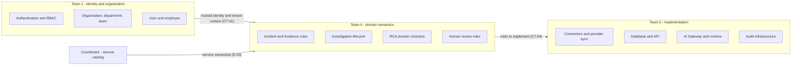
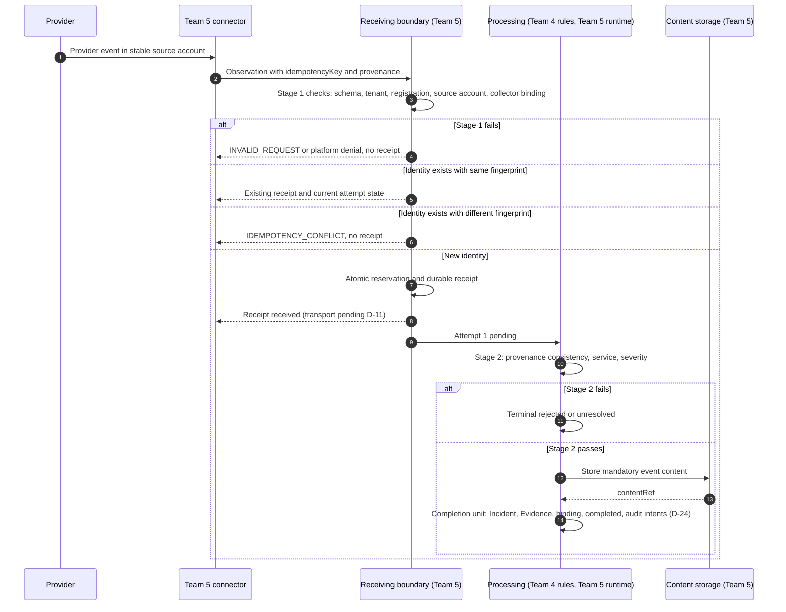
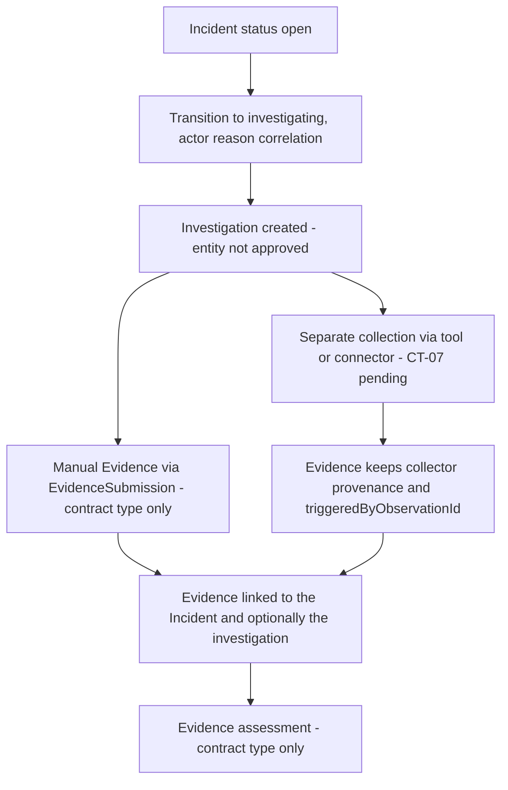
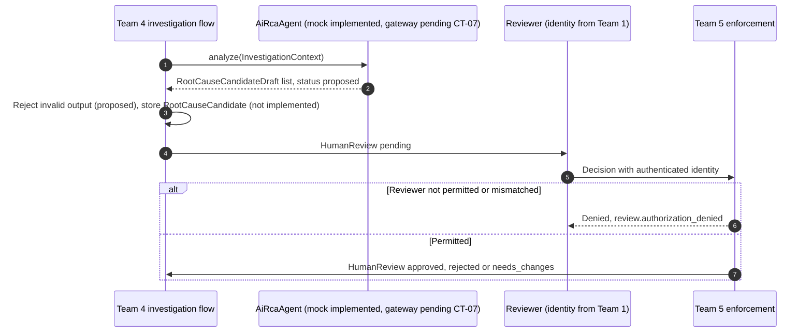
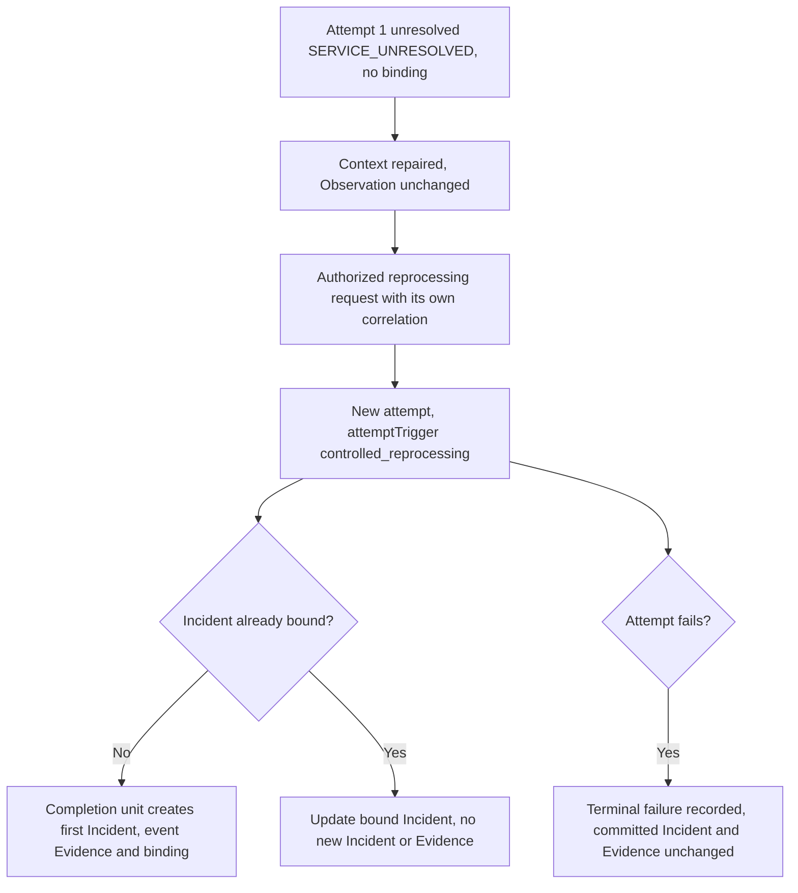
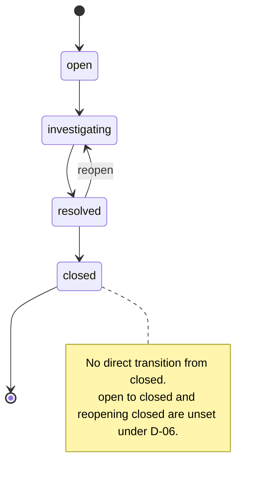

# Team 4 Domain Requirements and Mock Scenario Specification

## 1. Document Control

| Item | Value |
|---|---|
| Title | Team 4 Domain Requirements and Mock Scenario Specification |
| Version | `0.1.1-draft` |
| Owner | Team 4 — Incident Management & AI Root Cause Analysis |
| Implementation coordination | Team 5 |
| Contract reference | CT-04 Incident & Evidence Contract, revision `0.2.1-draft` ([`docs/contracts/CT-04-incident-evidence-v0.2-draft.md`](../contracts/CT-04-incident-evidence-v0.2-draft.md)) |
| Reference commit | `421ba6f` (`docs: record the CT-04 0.2.1 review checkpoint`) |
| Status | Draft for cross-team review |

**This document does not replace CT-04 and does not constitute implementation approval.** CT-04 remains the contract of record. Where this document and CT-04 differ, CT-04 wins and the difference is a defect in this document. Nothing here changes a decision status, accepts a Team 5 proposal, or authorizes schemas, migrations, routes, or live integrations.

### 1.1 Source verification

| Source | Location | Verified |
|---|---|---|
| CT-04 revision `0.2.1-draft` | [`docs/contracts/CT-04-incident-evidence-v0.2-draft.md`](../contracts/CT-04-incident-evidence-v0.2-draft.md) | Header reads `0.2.1-draft`. The working-tree file matches commit `421ba6f`, which added it. |
| Reference commit `421ba6f` | Git history on `main` | The commit exists and touches only the CT-04 v0.2 draft. **Limitation:** the CT-04 review checkpoint table does not itself record a reference commit. The commit was identified from Git history, not from the document. |
| CT-04 fixtures | CT-04 §12 | Exactly 27 acceptance fixture IDs: F-01 through F-26, plus F-02b. Separately, the CT-04 review checkpoint records 28 JSON examples. Those counts are not interchangeable (§13). |
| CT-04 decisions | CT-04 §14 | D-01 to D-26 found. Statuses are copied unchanged into §14. D-02 remains Needs Team 1 Input. |
| Prior domain revision | This file at commit `23eb53f` | `0.1-draft`. This revision keeps that history and corrects it. |
| Team 1 Integration Contract v1.0.0 | [`docs/contracts/team4_incident_management_integration_contract.md`](../contracts/team4_incident_management_integration_contract.md) | Header states Document Version 1.0.0, authored by Team 1. Present in the local working tree only. Untracked, and not part of commits `421ba6f` or `23eb53f`. Not assumed to exist in the remote repository. |
| Team 4 Team 1 compatibility audit | [`docs/contracts/CT-04-team1-compatibility-audit.md`](../contracts/CT-04-team1-compatibility-audit.md) | Team 4 assessment dated 2026-10-30. Its header compares Team 1 contract v1.0.0 with CT-04 `0.2-draft`, and states it is not a cross-team approval. Same local-only availability. Team 1 has not approved it. |
| Implementation baseline | `api/app/modules/*/contracts.py`, `api/app/shared/*.py`, `api/app/modules/ai_rca/mock_agent.py`, `api/tests/**` | Inspected (§1.3). |
| CT-04 v0.1 | [`docs/contracts/CT-04-incident-evidence-v0.1.md`](../contracts/CT-04-incident-evidence-v0.1.md) | Historical draft only; not used as a source of rules. |

### 1.2 Scope and exclusions

In scope:

- Team 4's domain responsibilities, concepts, business rules, and workflows.
- Mock API scenarios that exercise CT-04 behavior, using CT-04 synthetic data.
- Mapping of fixtures, decisions, and cross-team dependencies.
- A readiness assessment and open questions.

Excluded:

- Application code, Pydantic or SQLAlchemy models, tables, migrations, routes, or services.
- Final HTTP methods, paths, authentication headers, and status codes (pending Team 5 under D-11).
- Storage providers, URI formats, bucket layouts, and database schemas.
- Any change to CT-04, its fixtures, or its decision statuses.
- Live Team 1 or Team 5 connections.

### 1.3 Status vocabulary used in this document

| Term | Meaning here |
|---|---|
| **Implemented** | Exists in the repository today and is evidenced by code or tests. |
| **Contract type** | A Pydantic type exists, but no persistence, route, or service uses it. |
| **Proposed** | CT-04 proposed text. Not agreed. |
| **Team 5 proposal** | Recorded in CT-04 `0.2.1-draft` as a Team 5 implementation proposal. Not jointly accepted. |
| **Open** | No rule chosen, or explicitly unresolved in CT-04. |
| **Domain requirement** | A Team 4 requirement stated by this document and traced to CT-04. If it is not in CT-04, it is labeled **New question** or **Team 4 proposal**. |

Repository evidence for "Implemented":

| Item | Evidence |
|---|---|
| Health endpoints only | `api/app/api/router.py` includes only `routes/health.py`. |
| No ORM models | `api/app/db/models.py` imports `Base` only. |
| No migrations | `api/alembic/versions/` contains only `.gitkeep`. |
| Contract types | `api/app/modules/*/contracts.py`, `api/app/shared/identifiers.py`, `api/app/shared/contract.py`. |
| Deterministic mock RCA agent | `api/app/modules/ai_rca/mock_agent.py`, tested by `api/tests/unit/test_ai_rca.py`. |

### 1.4 Change history

| Version | Description |
|---|---|
| `0.1-draft` | Initial Team 4 domain requirements and mock scenarios, based on CT-04 `0.2.1-draft` at commit `421ba6f`. Preserved as commit `23eb53f`. |
| `0.1.1-draft` | Team 5 review corrections. §15 now cites the local Team 1 integration contract and Team 4 compatibility audit, and keeps confirmed details separate from open questions. F-11 no longer describes audit delivery as exactly once. The fixture inventory is the 27 CT-04 IDs; the 28 JSON examples stay a separate count. No application implementation or contract decision changed. |

---

## 2. System Context and Ownership

### 2.1 Team 4 domain responsibilities

| Responsibility | What Team 4 decides |
|---|---|
| Incident management | What an Incident is, which fields are required, the lifecycle, and the transition rules (CT-04 §6). |
| Evidence management | What Evidence is, its availability states, and its provenance rules (CT-04 §7). |
| Observation-to-incident behavior | When an Observation becomes an Incident and event Evidence, and how duplicates, conflicts, and failures behave (CT-04 §8–§10). |
| Investigation lifecycle | How an investigation relates to an Incident and its Evidence. The investigation entity is **not approved** (CT-04 §4.3). |
| AI Root Cause Analysis | RCA input and output meaning: candidates stay proposals (CT-04 §4.6, §11.3). |
| Human review and decisions | Which decisions require a human and what a valid approval means (CT-04 §11.3). |

### 2.2 Ownership boundaries

| Team | Owns | Source |
|---|---|---|
| Team 1 | Identity. Organization and tenant context. Employee, department, and team identity. Authentication and RBAC. | CT-04 §2.1; Team 1 contract §11 |
| Team 4 | Incident and Evidence semantics. Investigation lifecycle. RCA domain logic. Human review and domain decisions. Severity mapping meaning. | CT-04 §2.1, §2.3 |
| Team 5 | Connector infrastructure. Provider authentication and synchronization. AI Gateway and runtime. Database and API implementation coordination. Audit infrastructure. Usage tracking and technical execution. | CT-04 §2.1, §2.3 |
| Coordinator | Service catalog ownership, and service-to-team and service-to-user mappings. | CT-04 §2.3, D-03 |
| Team 2 | Projects and project membership. CT-04 defines no project field. | Team 1 contract §1.5 |

### 2.3 Domain ownership versus implementation ownership

Team 4 defines **what** is valid and **what** must happen. Team 5 builds the components that store, transport, and enforce those rules. For example:

- Team 4 says a completed ingestion must have exactly one Incident and one event Evidence with a valid `contentRef`. Team 5 decides how the transaction achieves that (D-24).
- Team 4 says a sender token is delivery metadata. Team 5 decides how it is stored and scoped (D-22).
- Team 4 says an AI candidate cannot confirm a cause. Team 5 enforces it at the execution boundary (CT-07).

A Team 5 proposal recorded in CT-04 is input to a joint decision. It is not Team 4 acceptance.



---

## 3. Domain Concept Catalogue

A **DTO** (data transfer object) is a shape used to move data, not a stored record. Several current Team 4 types are DTOs or projections. They are not canonical database entities.

### 3.1 Incident

| Aspect | Description |
|---|---|
| Purpose | The unit of operational response: something is wrong and someone must act. |
| Business meaning | A tenant-scoped record with title, severity, status, affected service, assignment, and external references. |
| Relationships | Has many Evidence records. May have investigations (entity not approved). May be bound to one Observation per ingestion. Status changes produce transition records and audit intents. |
| Owning team | Team 4 (semantics); Team 5 (persistence). |
| Current contract representation | `IncidentSummary` (`api/app/modules/incidents/contracts.py`): `id`, `title`, `status` (free string), `createdAt`, `externalRefs`. It is a **summary projection**, not the canonical Incident. The canonical shape is CT-04 §6.1 (**Proposed**). |
| Canonical persistence | **Not implemented.** Canonical fields Proposed; identifier formats D-01/D-02. |

### 3.2 Evidence

| Aspect | Description |
|---|---|
| Purpose | Information used to understand an Incident. |
| Business meaning | Metadata (description, source label, capture time, provenance, availability) plus an opaque reference to stored content. |
| Relationships | Belongs to exactly one Incident. May name one investigation of that Incident. Event Evidence comes from an Observation; separately collected Evidence may reference its trigger via `triggeredByObservationId`. |
| Owning team | Team 4 (semantics); Team 5 (storage and access). |
| Current contract representation | `EvidenceSubmission` (`api/app/modules/evidence_collection/contracts.py`): a **manual submission DTO**, not the canonical record. Canonical shape is CT-04 §7.3 (**Proposed**). |
| Canonical persistence | **Not implemented.** Storage is D-08 (Needs Team 5 Confirmation). |

### 3.3 Observation

| Aspect | Description |
|---|---|
| Purpose | A normalized provider signal delivered by Team 5's connector. |
| Business meaning | "The provider says this event happened in this source account." Team 4 decides whether it becomes an Incident. |
| Relationships | Has one receipt and one or more processing attempts. Binds to at most one Incident. Supplies the provenance for event Evidence. |
| Owning team | Team 4 (semantics); Team 5 (connector and receiving boundary). |
| Current contract representation | None. `IncidentIntake` (`api/app/modules/ingestion/contracts.py`) is the **manual/fixture intake** path, not an Observation. Observation is CT-04 §8.2 (**Proposed**). |
| Canonical persistence | **Not implemented.** |

### 3.4 Investigation

| Aspect | Description |
|---|---|
| Purpose | A structured effort to explain an Incident. |
| Business meaning | Groups evidence and RCA candidates for review. |
| Relationships | Belongs to an Incident (expected). Referenced by Evidence, `InvestigationContext`, `RootCauseCandidate`, `FixProposalDraft`, and `InvestigationHistoryEntry`. |
| Owning team | Team 4. |
| Current contract representation | `InvestigationId`, a type alias over `Team4EntityId`, and `as_investigation_id()`. The code states the `rca_investigation` entity, its foreign keys, and lifecycle are **not approved**. |
| Canonical persistence | **Unresolved.** No entity contract exists. |

### 3.5 Root Cause Candidate

| Aspect | Description |
|---|---|
| Purpose | A possible explanation of an Incident, generated by AI or a person, awaiting human review. |
| Business meaning | A proposal with rationale, confidence, uncertainty, missing information, and evidence links. Never a confirmed cause. |
| Relationships | Belongs to an investigation. Links to Evidence with a polarity. Subject of a `HumanReview`. |
| Owning team | Team 4. |
| Current contract representation | `RootCauseCandidateDraft` (AI output, `status` fixed `proposed`) and `RootCauseCandidate` (adds `id`, `investigationId`, `reviewRequired` fixed `true`). |
| Canonical persistence | **Not implemented.** Contract types only. |

### 3.6 Human Review

| Aspect | Description |
|---|---|
| Purpose | A recorded human decision on a candidate, fix proposal, or resolution. |
| Business meaning | Only an authorized human decision can advance an AI proposal. |
| Relationships | `subjectType` is `candidate`, `fix_proposal`, or `resolution`, with a `subjectId`. Reviewer identity comes from Team 1. |
| Owning team | Team 4 (workflow rules); Team 1 (reviewer identity and permissions); Team 5 (enforcement). |
| Current contract representation | `HumanReview` (`api/app/modules/reviews/contracts.py`): `id`, `subjectType`, `subjectId`, `decision` (`pending`, `approved`, `rejected`, `needs_changes`), optional `reviewerRef`, optional `decidedAt`, optional `rationale`. |
| Canonical persistence | **Not implemented.** |

### 3.7 External Reference

| Aspect | Description |
|---|---|
| Purpose | A pointer to a record that another team or provider owns. |
| Business meaning | `{ owner, id }`. Opaque: Team 4 does not parse it and it is not a foreign key. |
| Relationships | Used for `serviceRef`, `assignedTeamRef`, `assignedUserRef`, `actorRef`, `reviewerRef`, `externalRefs`, `sourceAccountRef`, and `collectorRef`. |
| Owning team | Team 4 (shape); the referenced owner (values). Owner-string registry is D-04. |
| Current contract representation | `ExternalRef` (`api/app/shared/identifiers.py`): frozen, rejects extra fields, values are unvalidated strings. |
| Canonical persistence | **Not applicable** as an entity. Non-empty rules Proposed (D-04). |

### 3.8 Source Account

| Aspect | Description |
|---|---|
| Purpose | The stable provider account an event belongs to. |
| Business meaning | Survives reconnects and connector replacement. Part of provider-event identity. |
| Relationships | Authorized for one or more connector registrations. Copied onto event Evidence provenance. |
| Owning team | Provider (identity); Team 5 (registration and authorization); Team 4 (identity semantics). |
| Current contract representation | `sourceAccountRef` in CT-04 §8.2 and §7.4 (**Proposed**). Not in code. |
| Canonical persistence | **Unresolved.** Format D-09/D-23. |

### 3.9 Connector Registration

| Aspect | Description |
|---|---|
| Purpose | The authenticated, replaceable connection a connector uses to submit data. |
| Business meaning | "Which connection delivered this." Not part of provider-event identity. |
| Relationships | Authorized for source accounts. Recorded as `provenance.collectorRef`. |
| Owning team | Team 5. |
| Current contract representation | `collectorRef` in CT-04 §7.4 (**Proposed**). Not in code. |
| Canonical persistence | **Unresolved.** D-21, D-23. |

### 3.10 Processing Attempt

| Aspect | Description |
|---|---|
| Purpose | One durable try at processing a received Observation. |
| Business meaning | Records status, error, mapping version, mapped severity, created Evidence, bound Incident, and correlation. |
| Relationships | Belongs to one receipt/Observation. Attempt 1 is `ingestion`; later attempts are `controlled_reprocessing`. |
| Owning team | Team 4 (semantics); Team 5 (execution). |
| Current contract representation | CT-04 §9.2 (**Proposed**). Not in code. |
| Canonical persistence | **Not implemented.** |

### 3.11 Processing Outcome

| Aspect | Description |
|---|---|
| Purpose | What a caller sees about an Observation's processing. |
| Business meaning | The receipt plus the latest attempt. Whether an Incident exists is decided by the Observation-to-Incident binding, not by the latest status (CT-04 §9.2). |
| Relationships | Derived from receipt, attempts, and binding. |
| Owning team | Team 4 (meaning); Team 5 (transport, D-11). |
| Current contract representation | CT-04 §9.1–§9.2 (**Proposed**). |
| Canonical persistence | **Not implemented.** Query mechanism is a Team 5 proposal (D-11). |

### 3.12 Audit Intent

| Aspect | Description |
|---|---|
| Purpose | A durable record that an auditable domain change happened, waiting for delivery to the audit sink. |
| Business meaning | Written in the same local transaction as the domain change (an "outbox" row). Delivered later. |
| Relationships | Produced by Incident changes, Evidence creation, Observation outcomes, review and remediation denials. |
| Owning team | Team 4 (which events and payload content); Team 5 / CT-06 (envelope, transport, delivery). |
| Current contract representation | CT-04 §11.4 and the F-07 payload (**Proposed**). `InvestigationHistoryEntry` and `TimelineEntry` exist as contract types but are not the audit outbox. |
| Canonical persistence | **Not implemented.** |

---

## 4. Incident Domain Requirements

All rules here are CT-04 **Proposed** text unless labeled otherwise. None is implemented.

### 4.1 Creation and identity

- The Incident `id` is generated by the persistence layer and never supplied by the caller (CT-04 §5, §6.1; D-01).
- Callers do not send `id`, `organizationId`, `status` on create, `createdAt`, or `updatedAt`. Those keys on input are rejected as unexpected.
- An Incident is created either by Observation ingestion (CT-04 §8.6) or by manual intake. Manual intake currently exists only as the `IncidentIntake` contract type.

### 4.2 Title and description

- `title`: required, trimmed, 1–255 characters (D-15).
- `description`: optional; empty after trim stored as `null`. Maximum length unset (D-15).

### 4.3 Severity and status

- Canonical severity: `critical`, `high`, `medium`, `low`.
- Provider severity is never stored as canonical severity. Team 4 maps (`source`, `externalSeverity`) through a versioned mapping. Each attempt records `severityMappingVersion` and `mappedSeverity` (D-05).
- Missing or unmapped severity: `unresolved` / `SEVERITY_UNMAPPED`. No silent default.
- Manual intake severity is set by an authorized user (CT-04 §6.1). **Gap:** the existing `IncidentIntake` type has no severity field.
- Initial status is `open`. Status changes only through the lifecycle below (D-06).

### 4.4 Lifecycle

**Proposed (D-06, status Proposed). Not implemented. Not agreed.**

| Current | Allowed next |
|---|---|
| `open` | `investigating` |
| `investigating` | `resolved` |
| `resolved` | `investigating` (reopen), `closed` |
| `closed` | No direct transition |

- `resolved → investigating` is the proposed reopening path.
- Closed incidents have no direct transition. `open → closed` and reopening a closed incident are unset under D-06.
- A request to set the status the record already has is not a transition and is rejected (Proposed).
- Resolving an Incident does not approve or execute remediation (CT-04 §11.3).

### 4.5 Transition record

Every status change conceptually captures (CT-04 §6.4, Proposed):

| Element | CT-04 field | Rule |
|---|---|---|
| Actor | `actorRef` | From the authenticated identity (CT-01). A different body-supplied actor is rejected. User-versus-employee form is D-02. |
| Timestamp | `occurredAt` | System-set, UTC `Z`. |
| Reason | `reason` | Trimmed, non-empty. |
| Correlation | `correlationId` | Non-empty. |
| From and to | `fromStatus`, `toStatus` | `fromStatus` equals the current status. |

Each transition emits one `incident.status_changed` audit intent in the same local transaction (CT-04 §11.4). Implementation and final acceptance are pending.

### 4.6 Source provenance

- Observation-derived Incidents come with exactly one event Evidence whose provenance is the Observation's provenance, unchanged (CT-04 §7.2, §8.5).
- The Incident keeps provider references in `externalRefs`, unique by (`owner`, `id`).

### 4.7 Tenant and organization context

- `organizationId` comes from trusted context only. A body value never establishes membership; on an Observation body it fails Stage 1 (CT-04 §11.1).
- Reads and writes stay inside the trusted organization. Another organization's resource is reported as not found.
- Format is D-02 (Needs Team 1 Input). Team 1's contract states organization IDs are UUIDs (§15). CT-04 examples use non-UUID synthetic values; those are illustrative only.

### 4.8 Team and department ownership snapshots

- CT-04 defines `assignedTeamRef` (optional, nullable) and no department field.
- Team 1 states team and department assignments are overwritten in place on transfer, and recommends Team 4 snapshot them (Team 1 contract §7, §12.3).
- **Open (not in CT-04):** whether the Incident stores immutable team/department snapshots. Raised by the compatibility audit. No field is defined here.

### 4.9 Reporter and assignee identity

- CT-04 defines `assignedUserRef` (optional, nullable). It defines no reporter field and no employee assignee field.
- Team 1 recommends `reported_by_user_id` (user) and `assigned_employee_id` (employee). These are Team 1 **recommendations**, not Team 4 schema.
- **Open:** user versus employee for assignment, and whether a reporter field exists (§15).

### 4.10 External provider references

- `externalRefs` is a required list, possibly empty, unique by (`owner`, `id`) (Proposed). The existing `IncidentSummary.externalRefs` is optional and nullable (CT-04 gap G-4).
- Provider ids are opaque and never become Team 4 ids.

### 4.11 Duplicate incident prevention

- One Observation binds to at most one Incident (CT-04 §9.5.1).
- Identical repeats of a provider event do not create another Incident in any processing state (CT-04 §10.5).
- Changed content under the same provider-event identity is an `IDEMPOTENCY_CONFLICT` with no second Incident (CT-04 §10.7).
- Grouping distinct provider events into one Incident is undefined (D-20, Open).

### 4.12 Update and closure

- Controlled reprocessing may update a bound Incident (for example corrected severity, F-13) without creating another.
- Closure is `resolved → closed`. Closure permission rules are not defined in CT-04. Team 1 suggests `MANAGER`/`ORG_ADMIN` for critical closure; that mapping is unconfirmed (§15).
- Which fields an authorized user may edit after creation (other than status and assignment) is **not defined in CT-04**. New question for Team 4.

---

## 5. Evidence Domain Requirements

### 5.1 Metadata, content, and external references

| Part | What it is | Where |
|---|---|---|
| Evidence metadata | The canonical record: type, description, source label, times, availability, provenance, `contentRef` | CT-04 §7.3 (Proposed) |
| Evidence content | The stored bytes (log window, metric series, event body) | Content storage (Team 5, D-08) |
| `contentRef` | An opaque reference from metadata to stored content | Format D-08 |
| `externalSourceRef` | An opaque pointer to the item in the provider | `ExternalRef` |

This document defines no storage provider, bucket structure, URI format, or schema.

### 5.2 Submission

- Manual submission uses the existing `EvidenceSubmission` contract type: `incidentId`, optional `investigationId`, `description`, `sourceLabel`, `capturedAt`, optional `externalSourceRef`. It is not the canonical record and has no provenance object (CT-04 §4.4).
- No route accepts it today.

### 5.3 Field rules (Proposed)

| Field | Rule |
|---|---|
| `description` | Trimmed, non-empty. |
| `sourceLabel` | Trimmed, 1–255. |
| `capturedAt` | Timezone-aware; canonical UTC `Z`. Current code keeps offsets (G-2). |
| `collectedAt` | System-set. |
| `externalSourceRef` | Optional `ExternalRef`. |
| `incidentId` | Required; Incident in the same organization. |
| `investigationId` | Optional; must belong to the same Incident when set. |

### 5.4 Provenance

- Origins: `observation`, `manual`, `tool_execution` (CT-04 §7.4).
- Event Evidence copies the Observation provenance unchanged, including `sourceAccountRef`.
- Separately collected Evidence carries the actual collector's provenance, never the triggering Observation's provider. `triggeredByObservationId` is a relationship, not provenance.

### 5.5 Mandatory versus optional Evidence

- Mandatory: one event Evidence per successful ingestion, with a valid `contentRef`. `completed` is impossible without it (CT-04 §8.6.1; D-07, D-08, D-19).
- Optional: logs, metrics, traces collected by separate operations. Their absence does not make ingestion `partial` (D-19).

### 5.6 Availability and failure handling

| `availability` | `contentRef` |
|---|---|
| `available` | Required and valid. |
| `partial` | Required for the stored portion; `description` states what is missing. |
| `unavailable` | `null`. |

- Transient mandatory storage failure: `retrying` / `EVENT_EVIDENCE_STORAGE_RETRYING`.
- Permanent mandatory storage failure: proposed `unresolved` / `EVENT_EVIDENCE_STORAGE_FAILED`, no canonical Incident result.
- Orphaned content (stored but unreferenced) is never Evidence (CT-04 §9.5.2).

### 5.7 Integrity and access

CT-04 requires only that `available` and `partial` point at stored bytes. Integrity verification, encryption, access control, retention, and deletion are D-08 and unset. Team 4 expects that Evidence access stays inside the trusted organization (CT-04 §11.1); the mechanism is Team 5's.

---

## 6. Observation and Ingestion Domain Requirements

### 6.1 Five distinct things

| Concept | Identity | Stable? | Role |
|---|---|---|---|
| Provider event | `sourceEventId` within tenant, provider, and source account | Provider-defined; Proposed immutable occurrence (D-25) | What happened in the provider |
| Stable source account | `sourceAccountRef` | Yes | Whose account the event belongs to |
| Connector registration | `provenance.collectorRef` | No; replaceable | Which authenticated connection delivered it |
| Observation | `observationId`, `deliveryId` | Assigned at first receipt | Team 4's received copy of the event |
| Incident | Incident `id` | Generated | The operational response |

**Provider-event identity is not connector registration identity.** The idempotency scope is tenant, `source`, `sourceAccountRef`, and `sourceEventId`. The registration instance is excluded (CT-04 §10.2; D-09, D-23).

### 6.2 Identity and provenance rules

| Rule | Stage | Source |
|---|---|---|
| Authenticated connector registration may submit for the organization | 1 | CT-04 §9.3 |
| Registration is authorized for the stable `sourceAccountRef` | 1 | §8.5, D-23 |
| `provenance.originType` is `observation` | 1 | §8.5, D-07 |
| `provenance.collectorRef` equals the authenticated registration | 1 | §8.5, D-21 |
| `provenance.sourceAccountRef` equals top-level `sourceAccountRef` | 1 | §8.5 |
| `provenance.provider` equals `source`, `provenance.sourceEventId` equals `sourceEventId` | 2 | §8.5; stage is D-21 |
| `sourceEventId` is provider-issued, never invented to bypass a conflict | Conformance | §10.9, D-25 |

Team 5 proposal (D-21/D-23, not jointly accepted): derive the authoritative collector identity from the authenticated registration, and validate access to the stable source account.

### 6.3 Idempotency key and delivery-token binding

- `idempotencyKey` is mandatory. Missing, `null`, or empty: Stage 1 `INVALID_REQUEST`, no receipt (D-09, F-16).
- It is delivery metadata, not provider-event identity and not business content.
- A changed token with identical content and identity is an identical duplicate.
- Same token reused for a different provider event: D-22 (**Open**). Team 5 proposes Candidate B — a delivery-token binding scoped separately from provider-event deduplication. Not jointly accepted.

### 6.4 Provider-event deduplication

- The fingerprint excludes `idempotencyKey`, `correlationId`, transport timestamps, and `provenance.collectorRef` (CT-04 §10.3).
- Same identity + same fingerprint: return the existing receipt and current attempt state.
- Same identity + different fingerprint: `IDEMPOTENCY_CONFLICT`, detected during atomic lookup before a second receipt.

### 6.5 Why reconnection must not create a second Incident

A provider account may be reconnected, or its connector replaced, and the new connection may resend recent events. If identity included the registration, the same provider event would look new and create a second Incident for one real occurrence. CT-04 therefore keys identity on the stable source account and excludes `collectorRef` from the fingerprint. The redelivery is an identical duplicate; stored provenance keeps the original collector (F-18).

---

## 7. Investigation Lifecycle

| Step | Current repository state | Status |
|---|---|---|
| Investigation creation | No entity, contract, or route. Only `InvestigationId` and `as_investigation_id()` exist. | Domain requirement; entity **not approved** |
| Association with an Incident | Not modeled. `IncidentContext` carries `externalIncidentRef`, not an Incident id. | Domain requirement |
| Evidence collection | `EvidenceSubmission` accepts an optional `investigationId`. Separate collection is CT-04 §7.2 (Proposed). | Contract type plus Proposed workflow |
| Evidence assessment | `EvidenceAssessment` contract type exists (`evidence_engine`). No service. | Contract type |
| AI RCA invocation | `AiRcaAgent.analyze(InvestigationContext)` protocol and a deterministic `MockAiRcaAgent`. | **Implemented as mock only** |
| Candidate generation | `RootCauseCandidateDraft` → `RootCauseCandidate` (tests construct one). | Contract types; no persistence |
| Human review | `HumanReview` contract type. | Contract type |
| Fix proposal, test plan, validation | `FixProposalDraft`, `TestPlanDraft`, `ValidationSummary` contract types. | Contract types |
| History | `InvestigationHistoryEntry`, `TimelineEntry` contract types. | Contract types |
| Resolution and closure | Incident lifecycle D-06 (Proposed). | Proposed |

Open questions carried from [`docs/architecture/incident-rca-workflow.md`](../architecture/incident-rca-workflow.md): investigation states and transitions, authorization rules, and whether one Incident may have concurrent investigations.

---

## 8. AI Root Cause Analysis

### 8.1 Current contracts (`api/app/modules/ai_rca/contracts.py`)

| Type | Fields | Role |
|---|---|---|
| `IncidentContext` | `externalIncidentRef` (optional), `summary`, `occurredAt` | Incident projection for analysis |
| `ContextEvidence` | `evidenceId`, `description`, `sourceRef` (optional) | Evidence projection for analysis |
| `InvestigationContext` | `investigationId`, `incident`, `evidence` | The complete analysis input |
| `CandidateEvidenceLink` | `evidenceId`, `polarity`, `explanation` | Ties a candidate to evidence |
| `RootCauseCandidateDraft` | `title`, `rationale`, `confidence`, `uncertainty`, `missingInformation`, `evidence`, `status` (`proposed`) | AI output |
| `AiRcaAgent` | `analyze(context) -> list[RootCauseCandidateDraft]` | Agent protocol |

`IncidentContext` and `ContextEvidence` are **projections**. They do not replace canonical Incident or Evidence records (CT-04 §4.6).

### 8.2 Meaning

- **Input context:** only what is in `InvestigationContext`. The agent cannot reference evidence outside it (F-05b, Proposed rejection).
- **Evidence polarity:** `supports`, `contradicts`, or `context`.
- **Confidence:** advisory. Currently an unbounded float (G-5). CT-04 proposes the range 0–1.
- **Uncertainty and missing information:** required lists; they tell the reviewer what is not known.
- **Status:** fixed `proposed`. AI output cannot confirm a cause; `confirmed` is rejected by existing code.

**An AI-generated candidate is not an approved human decision.** `RootCauseCandidate.reviewRequired` and `FixProposalDraft.requiresHumanReview` are fixed `true`.

### 8.3 What is implemented

- The protocol and a deterministic mock that returns one `proposed` candidate (confidence `0.25`, `context` links) or, with no evidence, an "Insufficient evidence" candidate with confidence `0`.
- Unit tests in `api/tests/unit/test_ai_rca.py` verify proposed status, evidence traceability, and camelCase serialization.

**Not implemented:** candidate persistence, AI Gateway integration (CT-07), live model calls, invalid-output rejection beyond Pydantic validation, and production execution.

---

## 9. Human Review and Governance

### 9.1 Domain workflow (Proposed)

1. A candidate, fix proposal, or resolution becomes a review subject with a `pending` `HumanReview`.
2. An authenticated human submits a decision: `approved`, `rejected`, or `needs_changes`.
3. The reviewer identity comes from the authenticated identity. A different body-supplied reviewer is rejected (CT-04 §11.2; F-06a).
4. The reviewer's permission is checked through CT-01. Permission names are Team 1's and are not defined in CT-04.
5. Remediation executes only after an approved review for that exact fix proposal, by a permitted reviewer, in the same organization (CT-04 §11.3; F-06b).
6. Denials are audited: `review.authorization_denied`, `remediation.execution_denied`.

### 9.2 Elements

| Element | Current representation | Status |
|---|---|---|
| Reviewer identity | `reviewerRef` (optional `ExternalRef`) | Contract type; identity form D-02 |
| Authorization | CT-01 permission context | Needs Team 1 Input |
| Decision | `decision` enum | Contract type |
| Reason | `rationale` (optional) | Contract type. Whether rationale is required for `rejected`/`needs_changes` is a **new question**. |
| Actor and timestamp | `reviewerRef`, `decidedAt` | Contract type |
| Approval count | Not defined | Open (CT-04 §11.3) |
| Audit | Denial events in CT-04; approval event name not defined | Partially Proposed |

### 9.3 User versus employee identity

Team 1 distinguishes `user_id` (authentication account) from `employee_id` (personnel record). A user may have no employee record. Team 1's own guidance for reviewers is inconsistent: §2.3 names `reviewed_by_user_id` with a target of "employee or user", while §9 uses `reviewed_by_employee_id`. This document does not choose either. The question is open with Team 1 (compatibility audit §8, question 5).

---

## 10. Processing and Reliability Requirements

### 10.1 Stages a caller can observe

| Stage | CT-04 representation |
|---|---|
| Request received | Durable receipt: `receiptStatus` `received` (§9.1). Stage 1 failures produce no receipt. |
| Processing started | Attempt `pending` with `processingStartedAt` set. |
| Processing retrying | `retrying` with a non-terminal `errorCode`. |
| Processing completed | `completed`: Incident, event Evidence, binding, terminal result, and audit intents committed. |
| Processing rejected | `rejected`: permanent domain failure after receipt (for example `PROVENANCE_MISMATCH`). |
| Processing unresolved | `unresolved`: missing context or retries exhausted (`SERVICE_UNRESOLVED`, `SEVERITY_UNMAPPED`, `PROCESSING_RETRY_EXHAUSTED`, `EVENT_EVIDENCE_STORAGE_FAILED`). |
| Processing partial | `partial`: a collection in scope stored only part of an item. Not used for missing optional evidence. |

### 10.2 Requirements

| Topic | Requirement (CT-04, Proposed unless noted) | Decisions |
|---|---|---|
| Durable receipt | Receipt confirms storage, not an Incident. Team 5 proposal: asynchronous durable receipt plus a tenant-authorized processing-status query. | D-11 |
| Processing attempt | Append-only once terminal. Attempt 1 `ingestion`; later `controlled_reprocessing`. | D-11, D-26 |
| Idempotency | Scope is tenant, source, stable source account, provider event. Atomic reservation. | D-09, D-23 |
| Duplicate handling | Return current state; never invent `completed`. | D-10, D-20 |
| Retry | Bounded automatic retry; counts unset. | D-12 |
| Controlled reprocessing | Never edits the Observation; first Incident at most once; failures preserve committed data. Team 5 proposal: idempotent retried reprocessing requests and serialization of conflicting work. | D-26 |
| Concurrency | Concurrent identical submissions yield one receipt (F-08). Concurrent reprocessing yields one Incident (F-21). | D-09, D-26 |
| Completion boundary | `completed` only after the five items commit. Team 5 proposal: one Phase 1 local transaction. Split minimum invariant remains until joint acceptance. | D-24 |
| Evidence storage recovery | Content storage is not atomic with the database; orphans are never Evidence. | D-08, D-24 |
| Audit outbox | Intent commits with the domain change. Sink delivery is asynchronous and bounded. Retries and recovery reuse the same `eventId`, which is the logical audit-event identity. A delivery attempt is not that identity: the sink deduplicates repeats, and delivery may occur more than once (F-11). | D-12 |

None of the Team 5 proposals above is accepted architecture.

### 10.3 Three correlation IDs (CT-04 §9.4)

| Correlation | Rule |
|---|---|
| Original observation | Set by the connector; immutable on the receipt. |
| Reprocessing request | New per request; not required to equal the original. |
| Processing attempt | Attempt 1 uses the original; reprocessing attempts use the request's; recovery keeps the attempt's. |

---

## 11. Domain Workflow Diagrams

Diagrams show intended domain behavior. Labels marked "proposed" or "pending" are not implemented. Nothing in these diagrams is implemented except the mock RCA agent, as stated.

### 11.1 Provider event ingestion to incident creation (proposed, not implemented)



### 11.2 Incident investigation and evidence collection (domain requirement, not implemented)



### 11.3 AI RCA candidate generation and human review (mock agent implemented; rest proposed)



### 11.4 Controlled reprocessing of an unresolved observation (proposed, not implemented)



### 11.5 Incident lifecycle and reopening (D-06 proposed, not implemented)



---

## 12. Mock API Scenarios

### 12.1 Conventions

- **All values are mock data.** They reuse CT-04's synthetic fixture values so each scenario maps directly to a fixture. `org_synth_0001` and similar identifiers are illustrative; Team 1 states real organization IDs are UUIDs (D-02).
- Requests and responses follow the CT-04 wire format: camelCase keys and UTC `Z` timestamps.
- **Transport pending Team 5 (D-11).** No HTTP method, path, authentication header, or status code is defined. "Submit" and "returns" describe contract effects only.
- Trusted context for observation scenarios: organization `org_synth_0001`; authenticated registration `team5.connector` / `conn_synth_monitor_01`, authorized for `synthetic-monitor` / `acct_synth_0001`.
- Where a scenario says "partial object", the JSON shows only changed fields and is not a complete request.

### 12.2 Base mock observation (`MOCK-OBS-BASE`)

Identical to CT-04 §8.7.

```json
{
  "source": "synthetic-monitor",
  "sourceAccountRef": { "owner": "synthetic-monitor", "id": "acct_synth_0001" },
  "sourceEventId": "evt-10001",
  "occurredAt": "2026-10-01T09:14:30Z",
  "occurredAtSupplied": null,
  "receivedAt": "2026-10-01T09:14:58Z",
  "submittedAt": "2026-10-01T09:14:59Z",
  "serviceRef": { "owner": "synthetic-monitor", "id": "checkout-api-prod" },
  "externalSeverity": "SEV2",
  "title": "Checkout API error rate above threshold",
  "description": "Synthetic monitor reported a 12% HTTP 5xx rate over 5 minutes.",
  "provenance": {
    "originType": "observation",
    "provider": "synthetic-monitor",
    "sourceEventId": "evt-10001",
    "sourceAccountRef": { "owner": "synthetic-monitor", "id": "acct_synth_0001" },
    "collectorRef": { "owner": "team5.connector", "id": "conn_synth_monitor_01" }
  },
  "idempotencyKey": "idem_synth_0001",
  "correlationId": "corr-synth-0001"
}
```

### MS-01 — Valid provider event ingestion

| Item | Value |
|---|---|
| Related fixtures | F-01, F-15a |
| Related decisions | D-05, D-07, D-09, D-11, D-12, D-19, D-24 |
| Business purpose | A valid provider alert becomes one Incident with its mandatory event Evidence. |
| Example request | `MOCK-OBS-BASE`. |
| Duplicate/idempotency | First delivery reserves the identity. |
| Audit | `incident.created`, `evidence.recorded` as outbox intents with `corr-synth-0001`. |
| Open dependencies | D-01 id formats, D-02 tenant format, D-03 service catalog, D-11 transport, D-24 transaction. |

Expected receipt:

```json
{
  "deliveryId": "44444444-4444-4444-8444-000000000001",
  "observationId": "33333333-3333-4333-8333-000000000001",
  "receiptStatus": "received",
  "receivedAt": "2026-10-01T09:15:00Z",
  "correlationId": "corr-synth-0001"
}
```

Expected processing outcome:

```json
{
  "deliveryId": "44444444-4444-4444-8444-000000000001",
  "observationId": "33333333-3333-4333-8333-000000000001",
  "attempt": 1,
  "attemptTrigger": "ingestion",
  "processingStatus": "completed",
  "incidentId": "11111111-1111-4111-8111-000000000001",
  "evidenceIds": ["22222222-2222-4222-8222-000000000001"],
  "severityMappingVersion": "synthetic-monitor-severity/v1",
  "mappedSeverity": "high",
  "errorCode": null,
  "errorMessage": null,
  "correlationId": "corr-synth-0001",
  "processingStartedAt": "2026-10-01T09:15:01Z",
  "processedAt": "2026-10-01T09:15:04Z"
}
```

Expected domain state: Incident `...0001` `open`, `severity` `high`, `serviceRef` `service-catalog` / `svc_synth_checkout`; event Evidence `...0001` `available` with the Observation's provenance (CT-04 §6.2, §7.5).

### MS-02 — Duplicate provider event

| Item | Value |
|---|---|
| Related fixtures | F-02, F-02b, F-08 |
| Related decisions | D-09, D-10, D-12, D-20 |
| Business purpose | Retries of the same event never create a second Incident or invent completion. |
| Example request | `MOCK-OBS-BASE` again. The token may differ; it is excluded from the fingerprint. |
| Expected receipt | The MS-01 receipt, unchanged. No new `deliveryId`. |
| Expected processing outcome | The stored attempt in its current state: `pending`, `retrying`, `unresolved`, `rejected`, `partial`, or `completed`. |
| Expected domain state | Still one Incident and one event Evidence. State not reset. |
| Duplicate/idempotency | Identical duplicate. Concurrent identical requests share one receipt (F-08). |
| Audit | Optional `observation.duplicate_delivery`. No second `incident.created`. |
| Open dependencies | D-09 uniqueness design, D-11 transport. |

Partial object (changed fields only):

```json
{
  "idempotencyKey": "idem_synth_0002",
  "correlationId": "corr-synth-0002"
}
```

### MS-03 — Same delivery token with changed business content

| Item | Value |
|---|---|
| Related fixtures | F-17, F-09 |
| Related decisions | D-09, D-10, D-22 |
| Business purpose | Token reuse never overwrites an accepted event. |
| Example request | MS-03a: `MOCK-OBS-BASE` with a changed `title` and the same token. MS-03b: the same token for new event `evt-10017`. |
| Expected receipt | MS-03a: none. MS-03b: depends on D-22. |
| Expected processing outcome | MS-03a: `IDEMPOTENCY_CONFLICT` under either candidate. MS-03b: Candidate A processes a new event; Candidate B rejects token reuse before a receipt (error code undefined). |
| Expected domain state | F-01 records unchanged. |
| Duplicate/idempotency | D-22 is **Open**. Team 5 proposes Candidate B; not jointly accepted. |
| Audit | MS-03a: `observation.idempotency_conflict`. |
| Open dependencies | D-22, token scope and retention. |

MS-03a partial object:

```json
{
  "title": "Checkout API latency above threshold",
  "idempotencyKey": "idem_synth_0001",
  "correlationId": "corr-synth-0171"
}
```

MS-03a response:

```json
{
  "error": {
    "code": "IDEMPOTENCY_CONFLICT",
    "message": "This provider event was already accepted with different content.",
    "details": []
  }
}
```

### MS-04 — Missing idempotency key

| Item | Value |
|---|---|
| Related fixtures | F-16 |
| Related decisions | D-09, D-22 |
| Business purpose | Every delivery must be traceable to a sender token. |
| Example request | `MOCK-OBS-BASE` without `idempotencyKey`, with `sourceEventId` and `provenance.sourceEventId` `evt-10016`, `correlationId` `corr-synth-0016`. |
| Expected receipt | None. No reservation, no attempt. |
| Expected processing outcome | None. |
| Expected domain state | Unchanged. |
| Duplicate/idempotency | A corrected resubmission is a first delivery. |
| Audit | None defined in CT-04 for schema failures. |
| Open dependencies | D-11 status code. |

```json
{
  "error": {
    "code": "INVALID_REQUEST",
    "message": "The request is invalid.",
    "details": [
      { "path": "body.idempotencyKey", "message": "Field required" }
    ]
  }
}
```

### MS-05 — Unauthorized source account

| Item | Value |
|---|---|
| Related fixtures | F-19, F-15c, F-15d |
| Related decisions | D-09, D-21, D-23 |
| Business purpose | A connector cannot submit for, or probe, an account it is not authorized for. |
| Example request | `MOCK-OBS-BASE` with `acct_synth_0099` in both `sourceAccountRef` fields and event `evt-10019`. |
| Expected receipt | None. Platform denial (CT-01; body not defined in CT-04). |
| Expected processing outcome | None. |
| Expected domain state | Unchanged. The denial does not disclose whether the account exists. |
| Duplicate/idempotency | Nothing reserved; a later authorized submission is a first delivery. |
| Audit | Authorization denial per CT-06 (event name undefined). |
| Open dependencies | D-21, D-23 Team 5 proposal (derive collector, validate account) not jointly accepted; CT-01. |

```json
{
  "sourceAccountRef": { "owner": "synthetic-monitor", "id": "acct_synth_0099" },
  "sourceEventId": "evt-10019",
  "provenance": {
    "originType": "observation",
    "provider": "synthetic-monitor",
    "sourceEventId": "evt-10019",
    "sourceAccountRef": { "owner": "synthetic-monitor", "id": "acct_synth_0099" },
    "collectorRef": { "owner": "team5.connector", "id": "conn_synth_monitor_01" }
  },
  "idempotencyKey": "idem_synth_0019",
  "correlationId": "corr-synth-0019"
}
```

### MS-06 — Connector reconnection

| Item | Value |
|---|---|
| Related fixtures | F-18 |
| Related decisions | D-04, D-09, D-10, D-20, D-23 |
| Business purpose | Reconnecting the same account must not duplicate Incidents. |
| Example request | `MOCK-OBS-BASE` resent through new registration `conn_synth_monitor_02`, with new transport times and token. |
| Expected receipt | The MS-01 receipt. |
| Expected processing outcome | The MS-01 completed attempt. |
| Expected domain state | One Incident. Stored provenance keeps `conn_synth_monitor_01`. |
| Duplicate/idempotency | Identical duplicate because `collectorRef` is excluded from identity and fingerprint. A submission through the revoked registration is a Stage 1 denial. |
| Audit | Optional `observation.duplicate_delivery`. |
| Open dependencies | D-23 registration-to-account mapping; diagnostic recording of the new registration. |

```json
{
  "receivedAt": "2026-10-05T08:00:00Z",
  "submittedAt": "2026-10-05T08:00:01Z",
  "provenance": {
    "originType": "observation",
    "provider": "synthetic-monitor",
    "sourceEventId": "evt-10001",
    "sourceAccountRef": { "owner": "synthetic-monitor", "id": "acct_synth_0001" },
    "collectorRef": { "owner": "team5.connector", "id": "conn_synth_monitor_02" }
  },
  "idempotencyKey": "idem_synth_0018",
  "correlationId": "corr-synth-0018"
}
```

### MS-07 — Repaired unresolved observation

| Item | Value |
|---|---|
| Related fixtures | F-03b, F-20 |
| Related decisions | D-03, D-05, D-11, D-12, D-24, D-26 |
| Business purpose | After context is fixed, a previously unresolved event creates its first Incident exactly once. |
| Example request | Ingestion: `MOCK-OBS-BASE` with `evt-10004`, `unknown-service-xyz`, `SEV3`. Later, an authorized reprocessing request with correlation `corr-synth-0020` (request shape pending D-11). |
| Expected receipt | Receipt `...0004` with `corr-synth-0004`; unchanged by reprocessing. |
| Expected processing outcome | Attempt 1 `unresolved` / `SERVICE_UNRESOLVED`. Attempt 2 `controlled_reprocessing`, `completed`, Incident `...0020`, Evidence `...0201`, `mappedSeverity` `medium`. |
| Expected domain state | Exactly one Incident bound to the Observation. |
| Duplicate/idempotency | Binding prevents a second Incident. |
| Audit | Attempt 1: `observation.unresolved`. Attempt 2: `incident.created`, `evidence.recorded` with `corr-synth-0020`. |
| Open dependencies | D-03 catalog ownership; D-11 reprocessing transport; D-26 Team 5 proposal. |

```json
{
  "deliveryId": "44444444-4444-4444-8444-000000000004",
  "observationId": "33333333-3333-4333-8333-000000000004",
  "attempt": 2,
  "attemptTrigger": "controlled_reprocessing",
  "processingStatus": "completed",
  "incidentId": "11111111-1111-4111-8111-000000000020",
  "evidenceIds": ["22222222-2222-4222-8222-000000000201"],
  "severityMappingVersion": "synthetic-monitor-severity/v1",
  "mappedSeverity": "medium",
  "errorCode": null,
  "errorMessage": null,
  "correlationId": "corr-synth-0020",
  "processingStartedAt": "2026-10-06T09:00:00Z",
  "processedAt": "2026-10-06T09:00:03Z"
}
```

### MS-08 — Repeated controlled reprocessing

| Item | Value |
|---|---|
| Related fixtures | F-21, F-13 |
| Related decisions | D-05, D-11, D-12, D-26 |
| Business purpose | Reprocessing again never duplicates the Incident. |
| Example request | A second reprocessing request with `corr-synth-0021`. |
| Expected receipt | Unchanged. |
| Expected processing outcome | Attempt 3 `completed`, same `incidentId`, `evidenceIds` empty. For F-13, a mapping change updates the bound Incident's severity. |
| Expected domain state | One Incident, one event Evidence. |
| Duplicate/idempotency | Team 5 proposal: retried reprocessing requests are idempotent and conflicting work is serialized. Not jointly accepted. |
| Audit | No `incident.created`. F-13: `incident.severity_corrected` (Proposed event type). |
| Open dependencies | D-26 concurrency mechanism. |

```json
{
  "deliveryId": "44444444-4444-4444-8444-000000000004",
  "observationId": "33333333-3333-4333-8333-000000000004",
  "attempt": 3,
  "attemptTrigger": "controlled_reprocessing",
  "processingStatus": "completed",
  "incidentId": "11111111-1111-4111-8111-000000000020",
  "evidenceIds": [],
  "severityMappingVersion": "synthetic-monitor-severity/v1",
  "mappedSeverity": "medium",
  "errorCode": null,
  "errorMessage": null,
  "correlationId": "corr-synth-0021",
  "processingStartedAt": "2026-10-06T10:00:00Z",
  "processedAt": "2026-10-06T10:00:01Z"
}
```

### MS-09 — Failed reprocessing

| Item | Value |
|---|---|
| Related fixtures | F-22 |
| Related decisions | D-03, D-12, D-26 |
| Business purpose | A failed reprocessing must not damage committed records. |
| Example request | Reprocessing request with `corr-synth-0022` after the catalog entry was removed. |
| Expected receipt | Unchanged. |
| Expected processing outcome | Attempt 4 `unresolved` / `SERVICE_UNRESOLVED`, `incidentId` the bound Incident `...0020`. |
| Expected domain state | Incident and Evidence unchanged; attempts 1–3 unchanged. |
| Duplicate/idempotency | Not applicable. |
| Audit | `observation.unresolved` with `corr-synth-0022`. |
| Open dependencies | D-03, D-26. |

```json
{
  "deliveryId": "44444444-4444-4444-8444-000000000004",
  "observationId": "33333333-3333-4333-8333-000000000004",
  "attempt": 4,
  "attemptTrigger": "controlled_reprocessing",
  "processingStatus": "unresolved",
  "incidentId": "11111111-1111-4111-8111-000000000020",
  "evidenceIds": [],
  "severityMappingVersion": null,
  "mappedSeverity": null,
  "errorCode": "SERVICE_UNRESOLVED",
  "errorMessage": "The affected service could not be resolved for this organization.",
  "correlationId": "corr-synth-0022",
  "processingStartedAt": "2026-10-07T09:00:00Z",
  "processedAt": "2026-10-07T09:00:01Z"
}
```

### MS-10 — Mandatory Evidence storage failure

| Item | Value |
|---|---|
| Related fixtures | F-14 |
| Related decisions | D-07, D-08, D-11, D-12, D-19 |
| Business purpose | No Incident claims completion without stored event content. |
| Example request | A valid new observation for event `evt-10014` (`idem_synth_0014`, `corr-synth-0014`). |
| Expected receipt | Receipt `...0014`, retained. |
| Expected processing outcome | Transient: `retrying` / `EVENT_EVIDENCE_STORAGE_RETRYING`. Permanent: `unresolved` / `EVENT_EVIDENCE_STORAGE_FAILED`, `incidentId` null. |
| Expected domain state | No completed canonical Incident; no `available` Evidence. |
| Duplicate/idempotency | A duplicate returns the current state. |
| Audit | `observation.event_evidence_storage_failed`. |
| Open dependencies | D-08 classification; whether provisional rows or `unavailable` markers exist. |

```json
{
  "deliveryId": "44444444-4444-4444-8444-000000000014",
  "observationId": "33333333-3333-4333-8333-000000000014",
  "attempt": 1,
  "attemptTrigger": "ingestion",
  "processingStatus": "unresolved",
  "incidentId": null,
  "evidenceIds": [],
  "severityMappingVersion": "synthetic-monitor-severity/v1",
  "mappedSeverity": "high",
  "errorCode": "EVENT_EVIDENCE_STORAGE_FAILED",
  "errorMessage": "Mandatory event evidence content could not be stored.",
  "correlationId": "corr-synth-0014",
  "processingStartedAt": "2026-10-03T09:15:01Z",
  "processedAt": "2026-10-03T09:16:00Z"
}
```

### MS-11 — Crash during completion

| Item | Value |
|---|---|
| Related fixtures | F-23 |
| Related decisions | D-08, D-12, D-24 |
| Business purpose | A crash cannot produce a false `completed` or a second Incident. |
| Example request | A valid new observation for event `evt-10023` (`idem_synth_0023`, `corr-synth-0023`). |
| Expected receipt | Receipt `...0023`. |
| Expected processing outcome | Single transaction: nothing canonical exists; attempt 1 resumes. Split variant: canonical rows exist, attempt stays `pending` until recovery records `completed` on the same attempt. |
| Expected domain state | Exactly one Incident `...0023` and one Evidence `...0231` after recovery. |
| Duplicate/idempotency | During the window a duplicate sees `pending`, never `completed`. |
| Audit | The local audit intent is committed with the canonical rows and is not written again during recovery. Sink delivery of that intent follows F-11 and may be repeated under the same `eventId`. |
| Open dependencies | D-24 Team 5 proposal (single Phase 1 transaction) not jointly accepted; visibility and recovery trigger. |

State during the split-variant window:

```json
{
  "deliveryId": "44444444-4444-4444-8444-000000000023",
  "observationId": "33333333-3333-4333-8333-000000000023",
  "attempt": 1,
  "attemptTrigger": "ingestion",
  "processingStatus": "pending",
  "incidentId": null,
  "evidenceIds": [],
  "severityMappingVersion": null,
  "mappedSeverity": null,
  "errorCode": null,
  "errorMessage": null,
  "correlationId": "corr-synth-0023",
  "processingStartedAt": "2026-10-08T09:00:01Z",
  "processedAt": null
}
```

### MS-12 — External content storage recovery

| Item | Value |
|---|---|
| Related fixtures | F-24 |
| Related decisions | D-08, D-12, D-24 |
| Business purpose | Stored content that never got committed is never treated as Evidence. |
| Example request | A valid new observation for event `evt-10024` (`idem_synth_0024`, `corr-synth-0024`). |
| Expected receipt | Receipt `...0024`. |
| Expected processing outcome | After the failed commit: `pending` or `retrying`. After recovery: `completed` with exactly one Evidence `...0241` and one valid `contentRef`. Repeated commit failure: `unresolved` / `PROCESSING_RETRY_EXHAUSTED`. |
| Expected domain state | Orphaned `content_synth_0241` unreferenced unless reused. |
| Duplicate/idempotency | Duplicates see the non-terminal state. |
| Audit | Completion audit intents are emitted when the attempt completes. Sink delivery follows F-11. |
| Open dependencies | Reuse versus rewrite of content; orphan cleanup (D-24). |

### MS-13 — Provider event content revision

| Item | Value |
|---|---|
| Related fixtures | F-25 |
| Related decisions | D-10, D-20, D-25 |
| Business purpose | A changed alert under an accepted id must not silently overwrite the Incident. |
| Example request | `MOCK-OBS-BASE` with `SEV1`, a new title, `idem_synth_0025`, `corr-synth-0025`. |
| Expected receipt | None. |
| Expected processing outcome | `IDEMPOTENCY_CONFLICT` under the interim rule. |
| Expected domain state | Incident `...0001` keeps `high` and its title. Known loss of the update. |
| Duplicate/idempotency | Fingerprint conflict. |
| Audit | `observation.idempotency_conflict`. |
| Open dependencies | D-25 is **Open**. Team 5 proposes enabling mutable alerts only after a provider-specific revision policy is agreed; not jointly accepted. |

```json
{
  "externalSeverity": "SEV1",
  "title": "Checkout API unavailable",
  "idempotencyKey": "idem_synth_0025",
  "correlationId": "corr-synth-0025"
}
```

### MS-14 — Fabricated provider event ID

| Item | Value |
|---|---|
| Related fixtures | F-26 |
| Related decisions | D-10, D-20, D-25 |
| Business purpose | A sender cannot bypass a conflict by inventing an id. |
| Example request | MS-13 content with `sourceEventId` and `provenance.sourceEventId` `evt-10001-r2`, `idem_synth_0026`, `corr-synth-0026`. |
| Expected receipt | Contract: the payload must not be sent. Detection mechanism pending Team 5. |
| Expected processing outcome | No second Incident for the provider occurrence. If undetected, a second Incident is a connector conformance defect. |
| Expected domain state | Incident `...0001` unchanged. |
| Duplicate/idempotency | Schema validation alone cannot detect fabrication. |
| Audit | Not defined. |
| Open dependencies | D-25 provider-id verification and outcome code. |

```json
{
  "sourceEventId": "evt-10001-r2",
  "externalSeverity": "SEV1",
  "title": "Checkout API unavailable",
  "provenance": {
    "originType": "observation",
    "provider": "synthetic-monitor",
    "sourceEventId": "evt-10001-r2",
    "sourceAccountRef": { "owner": "synthetic-monitor", "id": "acct_synth_0001" },
    "collectorRef": { "owner": "team5.connector", "id": "conn_synth_monitor_01" }
  },
  "idempotencyKey": "idem_synth_0026",
  "correlationId": "corr-synth-0026"
}
```

### MS-15 — Manual incident intake

| Item | Value |
|---|---|
| Related fixtures | None in CT-04. **Label for review.** |
| Related decisions | D-01, D-02, D-03, D-06, D-15 |
| Business purpose | An authorized user reports an Incident without a provider event. |
| Example request | Existing `IncidentIntake` wire shape (contract type only). |
| Expected receipt | Not defined. CT-04 receipts apply to Observations only. |
| Expected processing outcome | Not defined. Proposed: Incident `open`, `serviceRef` may be `null` for manual incidents (CT-04 §6.1). |
| Expected domain state | One Incident. **Gap:** `IncidentIntake` has no severity, yet CT-04 says an authorized user sets manual severity. |
| Duplicate/idempotency | Not defined for manual intake. New question. |
| Audit | Proposed `incident.created`. |
| Open dependencies | D-02 actor identity; reporter field (§15); manual duplicate policy. |

```json
{
  "source": "manual",
  "externalIncidentRef": null,
  "title": "Checkout page slow for internal users",
  "description": "Mock report from the operations desk.",
  "occurredAt": "2026-10-10T07:30:00Z"
}
```

### MS-16 — Evidence submission

| Item | Value |
|---|---|
| Related fixtures | F-04b (separate collection) for provenance only. Manual submission has no fixture. **Label for review.** |
| Related decisions | D-07, D-08, D-15, D-19 |
| Business purpose | A responder attaches evidence to an Incident. |
| Example request | Existing `EvidenceSubmission` wire shape (contract type only). |
| Expected receipt | Not defined. |
| Expected processing outcome | Proposed: canonical Evidence with `originType` `manual`, `collectorRef` the authenticated user. |
| Expected domain state | Evidence belongs to Incident `...0001`. How manual content is stored is D-08. |
| Duplicate/idempotency | Not defined. |
| Audit | Proposed `evidence.recorded`. |
| Open dependencies | D-08; whether manual submissions carry content or only metadata. |

```json
{
  "incidentId": "11111111-1111-4111-8111-000000000001",
  "investigationId": "55555555-5555-4555-8555-000000000001",
  "description": "Mock screenshot of the checkout error banner.",
  "sourceLabel": "Operations desk upload",
  "capturedAt": "2026-10-01T09:30:00Z",
  "externalSourceRef": null
}
```

### MS-17 — Investigation creation

| Item | Value |
|---|---|
| Related fixtures | None in CT-04. **Label for review.** |
| Related decisions | D-01, D-06 |
| Business purpose | Start a structured investigation of an Incident. |
| Example request | **No request contract exists.** Only `InvestigationId` exists. No payload is defined here. |
| Expected receipt | Not defined. |
| Expected processing outcome | Not defined. |
| Expected domain state | Investigation `55555555-5555-4555-8555-000000000001` associated with Incident `...0001` (domain requirement; entity not approved). |
| Duplicate/idempotency | Whether concurrent investigations per Incident are allowed is Open. |
| Audit | `InvestigationHistoryEntry` exists as a contract type; no event list defined. |
| Open dependencies | Investigation entity approval (RCA-001, ERD). |

### MS-18 — AI RCA candidate generation

| Item | Value |
|---|---|
| Related fixtures | F-05 |
| Related decisions | None listed in F-05. Relates to CT-04 §11.3 and CT-07. **Label for review.** |
| Business purpose | Produce reviewable candidate causes from investigation evidence. |
| Example request | `InvestigationContext` (existing contract; the mock agent is implemented). |
| Expected receipt | Not applicable. |
| Expected processing outcome | F-05a: one `proposed` candidate, `confidence` 0.4, a `supports` link; a pending review (Proposed). F-05b: invalid output rejected entirely (Proposed). |
| Expected domain state | Incident status unchanged by RCA. |
| Duplicate/idempotency | Not defined. |
| Audit | F-05b: `rca.output_rejected`. |
| Open dependencies | CT-07 gateway; candidate persistence; confidence range (G-5). |

```json
{
  "investigationId": "55555555-5555-4555-8555-000000000001",
  "incident": {
    "externalIncidentRef": { "owner": "synthetic-monitor", "id": "evt-10001" },
    "summary": "Checkout API error rate above threshold",
    "occurredAt": "2026-10-01T09:14:30Z"
  },
  "evidence": [
    {
      "evidenceId": "22222222-2222-4222-8222-000000000001",
      "description": "Provider alert: HTTP 5xx rate 12% over 5 minutes on checkout-api-prod.",
      "sourceRef": { "owner": "synthetic-monitor", "id": "evt-10001" }
    }
  ]
}
```

### MS-19 — Human review authorization

| Item | Value |
|---|---|
| Related fixtures | F-06 |
| Related decisions | D-02 (identity); none listed in F-06. **Label for review.** |
| Business purpose | Only a permitted, authenticated human can approve. |
| Example request | `HumanReview` approving a fix proposal, submitted by `user_synth_0042` but naming `user_synth_0001` as reviewer. |
| Expected receipt | Not applicable. |
| Expected processing outcome | Denied: reviewer mismatch and missing permission. An agent's execution request without approval is denied (F-06b). |
| Expected domain state | No `HumanReview` stored. Nothing executes. |
| Duplicate/idempotency | Not defined. |
| Audit | `review.authorization_denied`, `remediation.execution_denied`. |
| Open dependencies | Team 1 reviewer identity form and role mapping; approval count (Open). |

```json
{
  "id": "77777777-7777-4777-8777-000000000001",
  "subjectType": "fix_proposal",
  "subjectId": "88888888-8888-4888-8888-000000000001",
  "decision": "approved",
  "reviewerRef": { "owner": "team1.user", "id": "user_synth_0001" },
  "decidedAt": "2026-10-01T12:00:00Z",
  "rationale": "Mock approval used to show a reviewer mismatch."
}
```

### MS-20 — Incident resolution and reopening

| Item | Value |
|---|---|
| Related fixtures | F-07 (`investigating → resolved`). Reopening has no fixture. **Label for review.** |
| Related decisions | D-06, D-12 |
| Business purpose | Resolve an Incident and reopen it if the issue recurs. |
| Example request | Transition record for `resolved → investigating` (CT-04 §6.4 shape). |
| Expected receipt | Not applicable. |
| Expected processing outcome | Allowed under the proposed lifecycle. `closed → investigating` would be rejected. |
| Expected domain state | Incident `...0001` `investigating`. |
| Duplicate/idempotency | Setting the current status again is rejected (Proposed). |
| Audit | `incident.status_changed` intent in the same transaction; sink failure handled per F-07, F-11, F-12. |
| Open dependencies | D-06 acceptance; transition permissions (CT-01). |

```json
{
  "incidentId": "11111111-1111-4111-8111-000000000001",
  "fromStatus": "resolved",
  "toStatus": "investigating",
  "actorRef": { "owner": "team1.user", "id": "user_synth_0007" },
  "reason": "Mock recurrence: error rate rose again after the fix.",
  "correlationId": "corr-synth-0207",
  "occurredAt": "2026-10-02T08:00:00Z"
}
```

---

## 13. Acceptance Fixture Mapping

All fixtures are CT-04 documentation fixtures, not executable tests. Expected outcomes are **Proposed**. "Current status" reflects the decisions each fixture depends on.

| Fixture ID | Scenario name | Domain area | Related decisions | Expected behavior | Owning team | Current status | Dependencies |
|---|---|---|---|---|---|---|---|
| F-01 | Successful observation import and acknowledgment | Ingestion | D-05, D-07, D-09, D-12, D-19 | Receipt, completed attempt, one Incident, one event Evidence | Team 4 semantics; Team 5 implementation | Proposed fixture; not executable | D-11 transport, D-24 |
| F-02 | Duplicate delivery of a completed observation | Idempotency | D-09, D-10 | Original receipt and attempt; no new records | Team 4; Team 5 | Proposed fixture | D-09 uniqueness design |
| F-02b | Identical duplicate at each processing state | Idempotency | D-10, D-12, D-20 | Returns stored state; never invents `completed` | Team 4; Team 5 | Proposed fixture | D-20 Open |
| F-03 | Invalid payload or unresolved service mapping | Validation; service resolution | D-03, D-11, D-21 | Stage 1 `INVALID_REQUEST`; Stage 2 `SERVICE_UNRESOLVED` | Team 4; Team 5; Coordinator | Proposed fixture | D-03 coordinator |
| F-04 | Ingestion without optional evidence; separate collection | Evidence | D-07, D-08, D-19 | Ingestion `completed`; collection may be `partial` with collector provenance | Team 4; Team 5 (CT-07) | Proposed fixture | D-08 storage |
| F-05 | Valid structured RCA response and invalid output | AI RCA | None listed (label for review) | Valid draft becomes candidate; invalid response rejected | Team 4; Team 5 (CT-07) | Proposed fixture; mock agent implemented | CT-07, G-5 |
| F-06 | Unauthorized review or remediation | Human review | None listed (label for review) | Denials; no review stored; nothing executes | Team 4; Team 1; Team 5 | Proposed fixture | CT-01 permissions, D-02 |
| F-07 | Audit sink failure after local commit | Audit | D-12 | Status stays; intent retained; bounded retry | Team 5 (CT-06); Team 4 | Proposed fixture | Retry numbers unset |
| F-08 | Concurrent identical submissions | Concurrency | D-09, D-10 | One receipt, one observation, one attempt | Team 5; Team 4 | Proposed fixture | Uniqueness design |
| F-09 | Conflicting payload under the same provider event | Idempotency | D-10, D-12 | `IDEMPOTENCY_CONFLICT`; no overwrite | Team 4; Team 5 | Proposed fixture | HTTP status, replay policy |
| F-10 | Duplicate of unresolved work | Idempotency | D-10, D-12, D-20 | Returns `unresolved`; no reprocessing | Team 4; Team 5 | Proposed fixture | D-20 |
| F-11 | Crash after commit, before sink delivery | Audit | D-12 | The intent survives. Recovery may retry delivery after the crash, and each retry uses the same `eventId`. The sink deduplicates repeated deliveries by that `eventId`. Delivery may occur more than once. This is not exactly-once delivery: `eventId` is the logical audit-event identity, and each send is a separate delivery attempt. The Incident status is unchanged, and the audit event is not lost. | Team 5 (CT-06) | Proposed fixture | CT-06 |
| F-12 | Audit-record persistence failure | Audit | D-12 | Neither status nor intent commits | Team 5; Team 4 | Proposed fixture | Transaction design |
| F-13 | Reprocessing after severity mapping correction | Reprocessing; severity | D-05, D-11, D-12, D-26 | Attempt 2 updates bound Incident; own correlation | Team 4; Team 5 | Proposed fixture | D-05 version format, D-26 |
| F-14 | Mandatory event Evidence storage failure | Evidence; reliability | D-07, D-08, D-11, D-12, D-19 | `retrying` then `unresolved`; no completed Incident | Team 5; Team 4 | Proposed fixture | D-08 classification |
| F-15 | Observation provenance validation and collector binding | Provenance | D-07, D-21, D-23 | Stage 1 rejects bad origin or bindings; Stage 2 `PROVENANCE_MISMATCH` | Team 4; Team 5 | Proposed fixture; Team 5 proposal recorded | D-21, D-23 |
| F-16 | Missing idempotency key | Idempotency | D-09, D-22 | `INVALID_REQUEST`; no receipt | Team 4; Team 5 | Proposed fixture | D-11 status code |
| F-17 | Token reuse with changed content | Idempotency | D-09, D-10, D-22 | Conflict for same event; different event depends on D-22 | Team 5; Team 4 | Open (D-22); Team 5 proposes Candidate B | D-22 |
| F-18 | Connector reconnection with stable source account | Source identity | D-04, D-09, D-10, D-20, D-23 | Identical duplicate; provenance not rewritten | Team 5; Team 4 | Proposed fixture | D-23 |
| F-19 | Unauthorized source-account submission | Authorization | D-09, D-21, D-23 | Stage 1 denial; nothing reserved | Team 5; Team 1; Team 4 | Proposed fixture | CT-01, D-23 |
| F-20 | Repaired unresolved observation creates first Incident | Reprocessing | D-03, D-05, D-11, D-12, D-24, D-26 | First Incident exactly once | Team 4; Team 5; Coordinator | Proposed fixture; reviewed by Team 5 | D-03, D-26 |
| F-21 | Repeated reprocessing creates no new Incident | Reprocessing | D-11, D-12, D-26 | Same Incident; no new Evidence | Team 4; Team 5 | Proposed fixture; reviewed by Team 5 | D-26 |
| F-22 | Failed reprocessing preserves committed data | Reprocessing | D-03, D-12, D-26 | New failed attempt; records unchanged | Team 4; Team 5 | Proposed fixture; reviewed by Team 5 | D-03 |
| F-23 | Crash after canonical persistence, before completion | Completion boundary | D-08, D-12, D-24 | No false `completed`; recovery on same attempt | Team 5; Team 4 | Proposed fixture; reviewed by Team 5 | D-24 |
| F-24 | External content-storage recovery | Evidence storage | D-08, D-12, D-24 | Orphans never Evidence; one valid `contentRef` | Team 5; Team 4 | Proposed fixture; reviewed by Team 5 | D-08, D-24 |
| F-25 | Provider event content revision | Provider identity | D-10, D-20, D-25 | Interim `IDEMPOTENCY_CONFLICT` | Team 4; Team 5 | Open (D-25) | D-25 |
| F-26 | Bypass attempt with invented source event ID | Provider identity | D-10, D-20, D-25 | No second Incident; conformance defect if undetected | Team 5; Team 4 | Open (D-25) | D-25 verification |

Acceptance fixture IDs: 27 (F-01 through F-26, plus F-02b). JSON examples in CT-04 `0.2.1-draft`: 28, as recorded in that document's review checkpoint. A fixture may contain several JSON examples, and some JSON examples are shared contract samples rather than fixture IDs, so the two counts are not the same thing.

---

## 14. Decision Dependency Mapping

Statuses are copied from CT-04 §14 without change. "Blocks mocks" means it prevents preparing the mock scenarios in §12. "Blocks build" means it blocks schema or live implementation.

| ID | Topic | CT-04 status | Domain requirement | Team dependency | Blocks mocks | Blocks build |
|---|---|---|---|---|---|---|
| D-01 | Identifier format and generation | Proposed | Generated canonical ids | Team 4, Team 5 | No | Yes |
| D-02 | Tenant and actor identifiers | Needs Team 1 Input | Organization, actor, reviewer identity | **Team 1** | No (mock values labeled) | Yes |
| D-03 | Service catalog and service mapping | Needs Coordinator Confirmation | `serviceRef` resolution | **Coordinator** | No | Yes |
| D-04 | External reference namespace | Proposed | Non-empty `ExternalRef`; source-account owner | Team 4, Team 5 | No | Yes |
| D-05 | Severity mapping version | Proposed | Versioned mapping per attempt | Team 4, Team 5 | No | Yes |
| D-06 | Incident lifecycle | Proposed | Lifecycle and reopening | Team 4 | No | Yes |
| D-07 | Evidence types, availability, provenance | Proposed | Evidence semantics | Team 4, Team 5 | No | Yes |
| D-08 | Evidence storage and Phase 1 scope | Needs Team 5 Confirmation | `contentRef`, storage failures | Team 5 | No | Yes |
| D-09 | Idempotency scope | Proposed | Provider-event identity; mandatory key | Team 4, Team 5 | No | Yes |
| D-10 | Equality and duplicate semantics | Proposed | Fingerprint and conflicts | Team 4, Team 5 | No | Yes |
| D-11 | Validation stages and acknowledgment API | Proposed | Stages; transport. **Team 5 proposal:** asynchronous durable receipt and tenant-authorized status query (not jointly accepted). | Team 5 | Partially: transport is marked pending | Yes |
| D-12 | Audit persistence and recovery | Proposed | Outbox and bounded retry | Team 5, Team 4 | No | Yes |
| D-13 | Serialization | Proposed | camelCase; duplicate-key rejection | Team 4 | No | Yes |
| D-14 | Contract and API versioning | Needs Team 5 Confirmation | Wire versioning | Team 4, Team 5 | No | Yes |
| D-15 | Text field limits | Proposed | Title and label lengths | Team 4, Team 5 | No | Yes |
| D-16 | UTC, original timestamps, clock skew | Proposed | UTC `Z`; skew handling | Team 4, Team 5 | No | Yes |
| D-17 | Null and omitted fields | Proposed | Output `null`; input equivalence | Team 4, Team 5 | No | Yes |
| D-18 | Incident event time | Open | `occurredAt`/`detectedAt` on Incident | Team 4 | No | Yes |
| D-19 | Evidence collection scope and provenance | Proposed | Mandatory versus optional Evidence | Team 4, Team 5 | No | Yes |
| D-20 | Grouping and duplicate events | Open | Event grouping | Team 4 | No | Yes, for grouping |
| D-21 | Authorization vs domain validation | Needs Team 5 Confirmation | Collector and account binding. **Team 5 proposal:** derive collector identity, validate stable source-account access (not jointly accepted). | Team 5, Team 4 | No | Yes |
| D-22 | Sender idempotency token reuse | Open | Delivery-token binding. **Team 5 proposal:** Candidate B (not jointly accepted). | Team 5, Team 4 | No (both outcomes mocked) | Yes |
| D-23 | Stable source identity vs connector registration | Needs Team 5 Confirmation | Source account vs registration. **Team 5 proposal:** as D-21 (not jointly accepted). | Team 5, Team 4 | No | Yes |
| D-24 | Completion commit boundary and recovery | Needs Team 5 Confirmation | Completion unit. **Team 5 proposal:** single Phase 1 local transaction (not jointly accepted). | Team 5, Team 4 | No (both variants mocked) | Yes |
| D-25 | Provider event mutability and revisions | Open | Revision handling. **Team 5 proposal:** enable mutable alerts only after a provider-specific policy is agreed (not jointly accepted). | Team 4, Team 5 | No (interim rule mocked) | Yes, for mutable-alert providers |
| D-26 | Controlled reprocessing and correlation | Proposed | Reprocessing rules. **Team 5 proposal:** idempotent retried requests and serialized conflicting work (not jointly accepted). | Team 4, Team 5 | No | Yes |

No decision status was changed. No decision is Agreed.

---

## 15. Team 1 Integration Dependencies

### 15.1 Two different documents

| Document | What it is | Repository-relative path | Version and status | Availability |
|---|---|---|---|---|
| Team 1 integration contract | Team 1's documented integration contract for identity, organization, and personnel. | [`docs/contracts/team4_incident_management_integration_contract.md`](../contracts/team4_incident_management_integration_contract.md) | Document Version **1.0.0**. Authoring team: Team 1. | Present in this local working tree. Untracked. Not included in commits `421ba6f` or `23eb53f`. Do not assume it is in the remote repository. |
| Team 4 compatibility audit | Team 4's assessment of that contract against CT-04. It is not a Team 1 document and Team 1 has not approved it. | [`docs/contracts/CT-04-team1-compatibility-audit.md`](../contracts/CT-04-team1-compatibility-audit.md) | Dated 2026-10-30. Header status: documentation assessment only, not an implementation or cross-team approval. It compares the Team 1 contract with CT-04 `0.2-draft`, which is earlier than CT-04 `0.2.1-draft`. | Same local-only availability. |

**D-02 remains Needs Team 1 Input.** Neither document changes that status. The audit's classifications are Team 4 findings, not agreed decisions.

### 15.2 Confirmed integration details

These rows are facts stated by the Team 1 integration contract v1.0.0. Section numbers refer to that contract.

| Topic | Confirmed detail |
|---|---|
| UUID identifiers | `organization_id`, `department_id`, `team_id`, `employee_id`, and `user_id` are immutable RFC 4122 UUIDs. Business codes are mutable and are not primary foreign keys (§1.1, §2.1). |
| User versus employee | `user_id` is an authentication account. `employee_id` is a personnel record. A user may have no employee record (§2.2). |
| Organization context | A user record has no `organization_id`. Context is derived from employment, organization registration, and roles (§1.3). |
| Membership validation | A client-supplied organization id is untrusted. Team 1 documents validation through `GET /api/v1/auth/me` plus an employee read, or through an organization read that returns `403` for a non-member (§1.4, §8.3). |
| Department and team history | Transfers overwrite `team_id` and `department_id` in place. Team 1 keeps no assignment history and recommends that Team 4 snapshot them (§7, §12.2). The recommendation is not a Team 4 schema. |
| Reviewer recommendation | Team 1 recommends a reviewer or approver reference (§2.3, §9). Its own labels disagree, as recorded under open questions. |
| Role information | `GET /api/v1/auth/me` returns role codes. Team 1 suggests `MANAGER` or `ORG_ADMIN` for critical closure and RCA approval (§5.1, §6). That suggestion is not a confirmed CT-04 permission rule. |
| Employee lifecycle | `DELETE /employees/{id}` soft-deactivates the employee. Records are not hard-deleted (§7, §12.1). |
| Service-to-service authentication | Team 1 states that machine authentication is not implemented, and offers two options as recommendations only (§8.2). |
| Service ownership | Team 1 has no service catalog. The SQL in its §3.2 and §9 is marked as a recommendation, not an approved Team 4 schema (§3). |

### 15.3 Outstanding questions and dependencies

These remain open. Question numbers refer to §8 of the Team 4 compatibility audit.

| Topic | Outstanding question or dependency |
|---|---|
| Organization identifier in CT-04 | D-02 remains Needs Team 1 Input. CT-04 still treats `organizationId` as opaque. Whether a future contract stores Team 1 UUIDs as typed values or inside `ExternalRef` is unresolved. |
| User versus employee usage | Which form CT-04 uses for actor, assignee, reporter, and reviewer. |
| Users without employees | How Team 4 derives organization context for those users (audit question 2). |
| Membership source | Which Team 1 call is authoritative, and what caching or revocation is allowed (audit question 4). |
| Ownership snapshots | Whether CT-04 adds team or department snapshot fields (audit §6). |
| Reviewer identity | Team 1 §2.3 names `reviewed_by_user_id` while allowing an employee or user target; §9 uses `reviewed_by_employee_id` (audit question 5). This specification chooses neither. |
| Role mapping | Whether `MANAGER` and `ORG_ADMIN` are authoritative for CT-04 approvals (audit question 6). |
| Lifecycle notification | How Team 4 learns of deactivation or transfer (audit question 7), and Team 4's reassignment rule. |
| Machine authentication | Which mechanism, if any, is jointly chosen (audit question 8). |
| Service catalog | Coordinator ownership under D-03. |

---

## 16. Team 5 Implementation Dependencies

Items expected in Team 5's consolidated proposal. Nothing here is assumed accepted.

| Item | What Team 4 needs defined | Decisions | Fixtures |
|---|---|---|---|
| Database schemas and relationships | Incident, Evidence, Observation, receipt, attempt, binding, outbox | D-01, D-24 | F-01, F-20, F-23 |
| Unique constraints | Provider-event identity; one Incident per Observation binding | D-09, D-23, D-26 | F-02, F-08, F-18, F-21 |
| API transport | Methods, paths, status codes, sync/async, status query. Team 5 proposal recorded. | D-11 | F-01, F-03, F-16 |
| Source account representation | `sourceAccountRef` shape and stability | D-09, D-23, D-04 | F-18, F-19 |
| Connector authentication | Registration authentication; collector derivation. Team 5 proposal recorded. | D-21, D-23 | F-15, F-19 |
| Storage references | `contentRef` format, integrity, access, orphan handling | D-08, D-24 | F-14, F-24 |
| Retry and replay | Counts, backoff, replay of unresolved and audit | D-12 | F-07, F-11, F-14 |
| Idempotency and concurrency | Token binding (Candidate B proposed); reprocessing serialization (proposed) | D-22, D-26 | F-08, F-17, F-21 |
| Completion transaction | Single Phase 1 transaction (proposed) or split invariant | D-24 | F-23, F-24 |
| Audit outbox | Envelope, dispatcher, `eventId` deduplication | D-12 | F-07, F-11, F-12 |
| Versioning | Contract and wire version | D-14, D-05 | F-13 |
| Payload limits | Text maxima and payload size | D-15 | Label for review (no fixture) |
| Retention | Observations, tokens, intents, evidence content | D-08, D-09, D-12 | Label for review (no fixture) |

---

## 17. Implementation Readiness Assessment

**Documented domain requirements do not mean implemented software.**

| Area | Status | Basis |
|---|---|---|
| Domain understanding | Documented | This document and CT-04. |
| Contract definition | Partially documented | CT-04 `0.2.1-draft` is a draft; several decisions Open or awaiting confirmation. |
| Identity integration | Pending cross-team decision | D-02; Team 1 open questions. |
| Persistence | Pending implementation proposal | No ORM models or migrations; D-01, D-24. |
| API transport | Pending implementation proposal | D-11 proposal not jointly accepted; only health routes exist. |
| Evidence storage | Pending implementation proposal | D-08, D-24. |
| Processing reliability | Pending implementation proposal | D-09, D-12, D-22, D-26. |
| AI RCA integration | Not implemented | Contract types and a deterministic mock only; CT-07 pending. |
| Human review | Pending cross-team decision | `HumanReview` type only; reviewer identity and permissions pending Team 1. |
| Audit integration | Pending implementation proposal | D-12; CT-06. |
| Live service integration | Not implemented | No Team 1 or Team 5 connections. |

---

## 18. Open Questions and Risks

### 18.1 Team 1

1. Organization identifier form in CT-04 (D-02).
2. User, employee, or both for actor, assignee, reporter, and reviewer.
3. Organization context for users without employee records.
4. Authoritative membership and authorization source, and caching rules.
5. Reviewer identity: user UUID, employee UUID, or both.
6. Whether `MANAGER`/`ORG_ADMIN` are authoritative approval roles.
7. How Team 4 learns of employee deactivation and transfers.
8. Service-to-service authentication.

### 18.2 Team 5

1. Transport details under D-11 (methods, paths, status codes), building on the asynchronous-receipt proposal.
2. Source-account representation and registration mapping (D-23).
3. Collector derivation and Stage boundary (D-21).
4. Delivery-token scope and retention under the Candidate B proposal (D-22).
5. Completion transaction confirmation, split-window visibility, and recovery trigger (D-24).
6. Content storage reuse versus rewrite, orphan cleanup, and integrity (D-08, D-24).
7. Reprocessing concurrency and request idempotency mechanics (D-26).
8. Provider-id verification and mutable-alert capability (D-25).
9. Retry counts, backoff, retention, versioning, payload limits (D-12, D-14, D-15).

### 18.3 Coordinator

1. Service catalog owner and service-to-team and service-to-user mappings (D-03).

### 18.4 Team 4

1. Lifecycle edges `open → closed` and reopening a closed Incident (D-06).
2. Incident event time field (D-18).
3. Grouping distinct provider events (D-20), which also blocks revision-scoped ids (D-25).
4. **New question:** investigation entity, states, and concurrency per Incident.
5. **New question:** manual intake severity (`IncidentIntake` lacks it) and manual duplicate policy.
6. **New question:** editable Incident fields after creation.
7. **New question:** whether review rationale is required for `rejected` and `needs_changes`; approval count (Open in CT-04 §11.3).
8. **New question:** team/department snapshot fields, given Team 1's in-place overwrites.

### 18.5 Risks

| Risk | Impact | Mitigation in current documents |
|---|---|---|
| Building schemas before D-02/D-24 are agreed | Rework of identifiers and transactions | Readiness gate in §19 |
| Enabling mutable-alert providers before D-25 | Lost updates or duplicate Incidents | Interim conflict rule; Team 5 proposal to gate enablement |
| Treating mock fixtures as executable tests | False confidence | All fixtures labeled documentation-only |
| Team 1 reviewer ambiguity | Wrong approver semantics | Question kept open |

---

## 19. Next Steps

1. Team 4 completes domain and mock review of this document.
2. Team 1 resolves identity dependencies (§15, §18.1).
3. Team 5 supplies its consolidated implementation proposal (§16).
4. The coordinator resolves D-03.
5. Teams review the implementation proposal against the 27 acceptance fixture IDs: F-01 through F-26, plus F-02b.
6. Teams jointly accept the Phase 1 baseline, recording any Agreed decisions in CT-04.
7. Only then proceed with affected migrations and live integrations.
